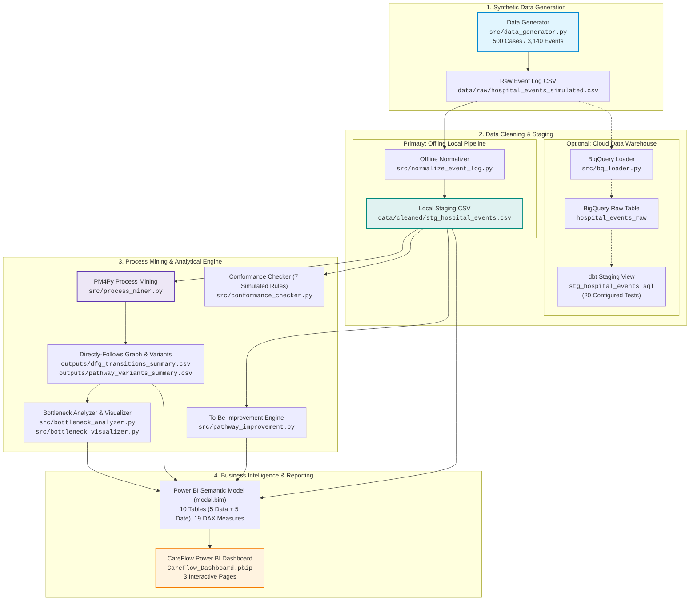
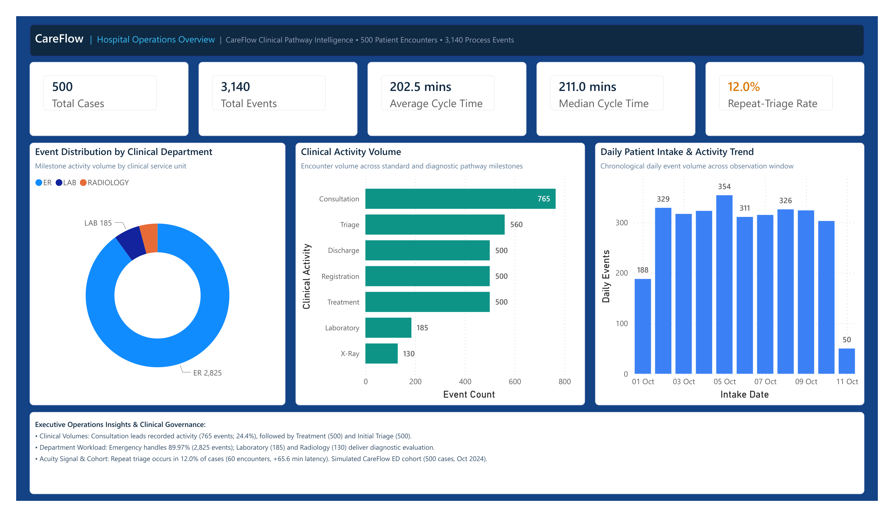
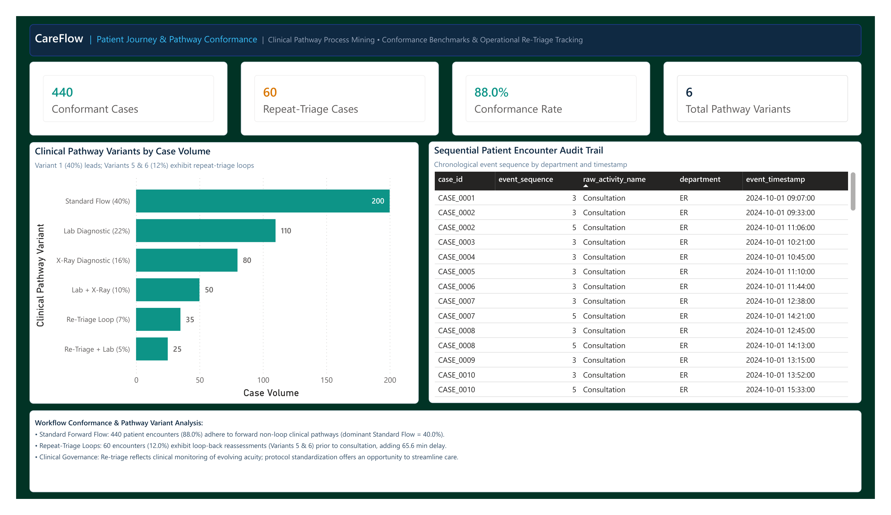
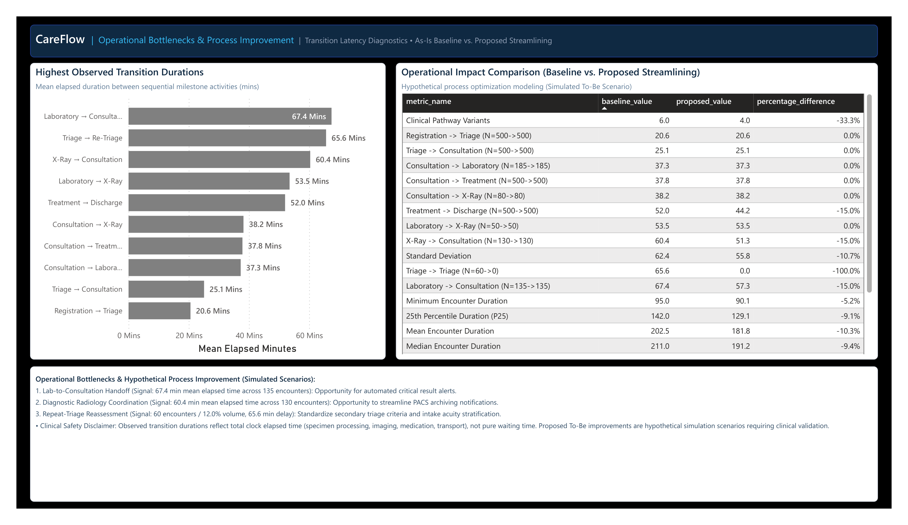

# CareFlow: Clinical Pathway Process Mining & Operations Analytics

[](https://www.python.org/)
[](https://pm4py.fit.fraunhofer.de/)
[-blue.svg)](https://cloud.google.com/bigquery)
[-orange.svg)](https://www.getdbt.com/)
[](https://learn.microsoft.com/en-us/power-bi/developer/projects/projects-overview)
[](tests/)

> **Project Overview:** CareFlow is an applied healthcare analytics internship project that analyzes Emergency Department (ED) patient event logs. Using process mining, SQL staging transformations, and dimensional reporting, the project identifies simulated clinical pathway patterns, detects secondary triage reassessment patterns, measures elapsed times between diagnostic milestones, checks rule-based workflow conformance, and presents insights through an interactive 3-page Power BI dashboard.

---

> [!IMPORTANT]
> **Simulated Data Provenance & Clinical Safety Notice**
> All event log data in this repository is **100% synthetic (simulated Electronic Health Record encounters)**, generated across an observation window of **October 1–11, 2024** (500 patient encounters, 3,140 chronological milestone events). It contains no Protected Health Information (PHI) or real patient records.
>
> *Operational Notes:*
> 1. **Elapsed Transition Duration vs. Patient Waiting Time:** Recorded transition latencies measure the total elapsed clock time between recorded activity timestamps, not confirmed patient waiting room duration. The event log records discrete milestone completion timestamps and does not measure unrecorded internal sub-processes.
> 2. **Hypothetical Improvement Scenarios:** The "To-Be" streamlined workflow projections are simulated scenario models created to explore potential queue improvements and require clinical validation before real-world operational use.

---

## Table of Contents

1. [Problem Context & Project Objectives](#problem-context--project-objectives)
2. [Key Operational Metrics](#key-operational-metrics)
3. [System Architecture](#system-architecture)
4. [Interactive Power BI Dashboard](#interactive-power-bi-dashboard)
   - [Page 1: Hospital Operations Overview](#page-1-hospital-operations-overview)
   - [Page 2: Patient Journey & Pathway Conformance](#page-2-patient-journey--pathway-conformance)
   - [Page 3: Operational Bottlenecks & Process Improvement](#page-3-operational-bottlenecks--process-improvement)
   - [Opening the PBIP Project](#opening-the-pbip-project)
5. [Process Mining & Analytical Methodology](#process-mining--analytical-methodology)
   - [Clinical Pathway Variants](#clinical-pathway-variants)
   - [Observed Transition Bottlenecks](#observed-transition-bottlenecks)
   - [Workflow Conformance Auditing](#workflow-conformance-auditing)
   - [As-Is Baseline vs. To-Be Simulated Improvement](#as-is-baseline-vs-to-be-simulated-improvement)
6. [Technology Stack](#technology-stack)
7. [Repository Structure](#repository-structure)
8. [Installation & Execution Guide](#installation--execution-guide)
   - [Tier 1: 100% Offline Local Pipeline (Recommended)](#tier-1-100-offline-local-pipeline-recommended)
   - [Tier 2: Optional Google Cloud & dbt Staging](#tier-2-optional-google-cloud--dbt-staging)
9. [Testing & Verification](#testing--verification)
10. [Mentor Submission ZIP Packaging Guide](#mentor-submission-zip-packaging-guide)
11. [Author & Internship Background](#author--internship-background)

---

## Problem Context & Project Objectives

Emergency Departments are complex clinical environments where delays and variable patient journeys can be difficult to track with high-level summary metrics alone. Typical hospital reports show general statistics like *"Average ED duration: 3.4 hours"*, but they often miss:

- **Pathway Variations:** Which diagnostic routes take the longest from intake to discharge?
- **Secondary Reassessments:** How frequently do patients undergo repeat triage evaluations, and what elapsed transition time does that add?
- **Departmental Handoff Times:** Where do the longest handoff times occur between clinical units (such as Laboratory results turnaround or Radiology review)?
- **Workflow Conformance:** How many encounters follow standard forward clinical sequences versus non-standard flow patterns?

### Project Goals
1. **Generate Realistic Synthetic Data:** Create a reproducible 500-case event log (3,140 events) representing realistic emergency room workflows with probabilistic diagnostic paths and secondary triage loopbacks.
2. **Transform & Stage Event Logs:** Build a local Python normalization pipeline that standardizes event logs, with an optional Google BigQuery and dbt Core staging model featuring 20 configured schema and data tests.
3. **Discover Workflows with Process Mining:** Use PM4Py to extract Directly-Follows Graphs (DFGs), discover clinical pathway variants, and calculate transition time distributions.
4. **Analyze Bottlenecks & Conformance:** Evaluate 7 simulated workflow-conformance rules, audit secondary triage reassessments, and model a hypothetical "To-Be" streamlined care scenario.
5. **Present Insights in Power BI:** Build a 3-page Power BI Project (`.pbip`) using native DAX measures and custom styling to communicate operational findings.

---

## Key Operational Metrics

The primary operational metrics below are calculated directly from the simulated dataset and Python analytical outputs, with selected summary metrics presented in the Power BI dashboard. BigQuery warehousing and dbt staging models are optional integrations.

| Category | Metric Name | Value | Description |
| :--- | :--- | :---: | :--- |
| **Cohort Volume** | **Total Patient Encounters** | **500** | Total discrete simulated patient journeys |
| | **Total Process Events** | **3,140** | Total recorded clinical milestone events |
| **Encounter Duration** | **Mean Cycle Time** | **202.54 mins** (~202.5 mins) | Average elapsed time from Registration to Discharge |
| | **Median Cycle Time** | **211.00 mins** (211.0 mins) | 50th percentile patient encounter duration |
| | **Interquartile Range (P25 – P75)** | **142.0 – 250.0 mins** | Middle 50% of patient encounter durations |
| | **90th Percentile Duration (P90)** | **284.00 mins** | 90% of encounters have recorded durations at or below 284 mins (Maximum duration: 354.0 mins) |
| **Workflow Conformance**| **Workflow Conformance Rate** | **88.0% (440 cases)** | Adherence to standard forward clinical pathways (Variants 1–4) |
| | **Repeat-Triage Cases** | **60 cases (12.0%)** | Encounters undergoing secondary triage reassessment (Variants 5 & 6) |
| | **Repeat-Triage Transition Time**| **65.63 mins** | Observed mean elapsed transition time during secondary triage reassessment (not confirmed patient waiting time) |
| | **Discovered Pathway Variants** | **6 variants** | Most frequent: Standard Forward Flow (40.0% / 200 cases) |
| **Observed Bottlenecks** | **#1 Bottleneck (Diagnostic)** | **67.44 mins** | `Laboratory -> Consultation` handoff ($N=135$) |
| | **#2 Bottleneck (Reassessment)**| **65.63 mins** | `Triage -> Triage` secondary reassessment ($N=60$) |
| | **#3 Bottleneck (Radiology)** | **60.36 mins** | `X-Ray -> Consultation` image review ($N=130$) |
| **Simulated Optimization**| **To-Be Mean Cycle Time** | **181.8 mins (-10.2%)** | Hypothetical reduction of -20.7 mins via simulated queue optimization |
| | **To-Be Median Cycle Time** | **191.2 mins (-9.4%)** | Hypothetical reduction of -19.8 mins in simulated median duration |

---

## System Architecture

The project is structured around a local analytical pipeline with an optional cloud warehouse pathway:



---

## Interactive Power BI Dashboard

The dashboard is built in the developer-friendly **Power BI Project (`.pbip`)** format. It includes version-controlled visual layouts in `report.json`, semantic model definitions in `model.bim` (TMSL JSON format), and custom styling (`CY26SU05.json`).

> **Note on Dashboard Screenshots:** The screenshots below were exported from the finalized 3-page report in Power BI Desktop on November 14, 2026. The current Power BI Desktop report was exported to PDF and each page was rendered as a high-resolution PNG (2988 × 1728 pixels). Open `CareFlow_Dashboard.pbip` in Power BI Desktop to explore the interactive report.

### Page 1: Hospital Operations Overview
Presents high-level encounter volumes, clinical activity distributions, encounter duration KPIs, and key operations takeaways.



- **KPI Cards:** Total Cases (500), Total Process Events (3,140), Mean Cycle Time (202.5 mins), Median Cycle Time (211.0 mins), and Repeat Triage Rate (12.0%).
- **Departmental Workload:** Donut chart showing Emergency Department volume (89.97% / 2,825 events) alongside Laboratory (185 events) and Radiology (130 events).
- **Clinical Activity Volume:** Horizontal bar breakdown showing Physician Consultation as the most frequent activity (765 events; 24.4% of total recorded activity), followed by Triage (560), Registration (500), Treatment (500), Discharge (500), Laboratory (185), and X-Ray (130).
- **Daily Event Volume Trend:** Chronological column chart tracking total recorded clinical event volume across the 11-day simulation period (peaking at 354 events on October 6, 2024; reflects milestone activity load rather than unique patient arrival census).
- **Operations Insights:** Summary points detailing high-volume care milestones, service unit share, and secondary triage latency observations.

---

### Page 2: Patient Journey & Pathway Conformance
Focuses on workflow adherence, pathway variant frequencies, and chronological encounter audit trails.



- **Conformance KPIs:** Conformant Cases (440), Repeat Triage Cases (60), Conformance Rate (88.0%), and Total Pathway Variants (6).
- **Pathway Variant Volume:** Ranked bar chart showing case counts across all 6 discovered variants, led by the Standard Forward Flow (40.0% / 200 cases).
- **Patient Encounter Audit Trail (`tbl_case_audit`):** Chronological table displaying individual patient milestones with displayed columns: `Case ID`, `Event Sequence`, `Activity Name`, `Department`, and `Event Timestamp` (subtitle: *"Chronological event sequence by department and timestamp"*).
- **Workflow Governance Notes:** Contextual notes documenting that secondary triage reassessments represent observed repeat evaluations prior to physician consultation, rather than procedure completion errors.

---

### Page 3: Operational Bottlenecks & Process Improvement
Compares baseline transition latencies with an illustrative, simulated "To-Be" streamlined workflow.



- **Bottleneck Transition Ranking:** Horizontal bar chart highlighting the longest observed transition times, led by Laboratory-to-Consultation notification (67.4 mins mean elapsed time) and Triage-to-Triage secondary reassessment (65.6 mins mean elapsed time).
- **Baseline vs. Proposed Comparison Table:** Comparative matrix displaying duration percentiles (P25, P75, P90, Mean, Median, Min, Max) comparing current operations with a simulated improvement model.
- **Clinical Safety Disclaimer:** Explanatory banner noting that observed durations reflect total elapsed time (not idle waiting time) and that simulated improvements are hypothetical operational models requiring clinical review.

---

### Opening the PBIP Project

To open and explore the Power BI dashboard:

1. Install [Power BI Desktop](https://powerbi.microsoft.com/desktop/) (June 2023 release or newer).
2. Open the project file:
   ```text
   powerbi/CareFlow_Dashboard_Project/CareFlow_Dashboard.pbip
   ```
3. Power BI Desktop will compile the semantic model from `model.bim` and load the layout from `report.json`.
4. *Data Source Path Note:* Power Query M expressions inside `model.bim` hardcode absolute Windows paths referencing `C:\project\careflow-clinical-pathway\`. If your cloned repository resides at a different directory or drive, select **Transform Data $\to$ Data Source Settings** in Power BI Desktop to point the source file paths to your local `data/cleaned/stg_hospital_events.csv` and `outputs/*.csv` files.

---

## Process Mining & Analytical Methodology

### Clinical Pathway Variants

Using PM4Py trace extraction, the 500 patient encounters were grouped into **6 distinct clinical pathway variants**:

| Variant | Activity Sequence | Case Count | Cohort % | Clinical Description |
| :---: | :--- | :---: | :---: | :--- |
| **Variant 1** | `Reg -> Triage -> Consult -> Treat -> Disch` | **200** | **40.0%** | **Standard Flow:** Acute non-diagnostic pathway. |
| **Variant 2** | `Reg -> Triage -> Consult -> Lab -> Consult -> Treat -> Disch` | **110** | **22.0%** | **Lab Diagnostic:** Pathology evaluation with follow-up consult. |
| **Variant 3** | `Reg -> Triage -> Consult -> X-Ray -> Consult -> Treat -> Disch` | **80** | **16.0%** | **X-Ray Diagnostic:** Radiology evaluation with physician review. |
| **Variant 4** | `Reg -> Triage -> Consult -> Lab -> X-Ray -> Consult -> Treat -> Disch` | **50** | **10.0%** | **Comprehensive Diagnostic:** Sequential lab and imaging tests. |
| **Variant 5** | `Reg -> Triage -> Triage -> Consult -> Treat -> Disch` | **35** | **7.0%** | **Repeat Triage Flow:** Secondary acuity assessment prior to consult. |
| **Variant 6** | `Reg -> Triage -> Triage -> Consult -> Lab -> Consult -> Treat -> Disch` | **25** | **5.0%** | **Repeat Triage + Diagnostic:** Secondary assessment with lab testing. |

---

### Observed Transition Bottlenecks

Directly-Follows Graph (DFG) edges were analyzed to calculate elapsed durations across all 10 observed milestone transitions. The event log records discrete activity milestone timestamps; intermediate sub-steps are not measured directly in the data. The top 5 transitions by mean elapsed time are (verified against `outputs/bottleneck_analysis_summary.csv`):

| Rank | Milestone Transition | Observed Count ($N$) | Mean Elapsed Time | Median Elapsed Time | Operational Milestone Context |
| :---: | :--- | :---: | :---: | :---: | :--- |
| **1** | `Laboratory -> Consultation` | 135 | **67.44 mins** | 67.00 mins | Observed interval between laboratory completion and subsequent consultation. |
| **2** | `Triage -> Triage` | 60 | **65.63 mins** | 64.50 mins | Observed interval between consecutive nursing triage assessments (not confirmed patient waiting time). |
| **3** | `X-Ray -> Consultation` | 130 | **60.36 mins** | 61.00 mins | Observed interval between X-ray completion and subsequent consultation. |
| **4** | `Laboratory -> X-Ray` | 50 | **53.50 mins** | 51.00 mins | Observed interval between sequential diagnostic events (Lab to X-Ray). |
| **5** | `Treatment -> Discharge` | 500 | **52.01 mins** | 52.00 mins | Observed post-treatment interval prior to recorded discharge. |

---

### Workflow Conformance Auditing

Patient traces were evaluated against **7 simulated workflow-conformance rules** (`src/conformance_checker.py`):

1. `RULE_START_ACTIVITY`: Encounters must begin with `Registration` (100% adherence / 500 cases).
2. `RULE_END_ACTIVITY`: Encounters must conclude with `Discharge` (100% adherence / 500 cases).
3. `RULE_MANDATORY_ACTIVITIES`: Encounters must include Registration, Triage, Consultation, Treatment, and Discharge (100% adherence / 500 cases).
4. `RULE_ACTIVITY_ORDER`: Forward clinical order enforced; Consultation must precede Treatment (100% adherence).
5. `RULE_DIAGNOSTIC_FOLLOWUP`: Diagnostic tests (Lab, X-Ray) must be preceded by an initial consultation and reviewed in a follow-up consultation before treatment (100% adherence across all 265 diagnostic-pathway encounters in Variants 2, 3, 4, and 6).
6. `RULE_REPEATED_TRIAGE`: Encounters with consecutive triage events (`Triage -> Triage`) are flagged as operational review candidates (440 conformant / 60 flagged = **88.0% conformance rate**).
7. `RULE_DUPLICATE_EVENTS`: Detects identical repeated timestamps or duplicate records (0 detected).

---

### As-Is Baseline vs. To-Be Simulated Improvement (Hypothetical Scenario Modeling)

The simulation script (`src/pathway_improvement.py`) models an exploratory scenario to evaluate the mathematical effect of hypothetical workflow adjustments on encounter duration metrics. These adjustments are exploratory modeling assumptions, not validated clinical recommendations or measured real-world outcomes:
- **Hypothetical Direct Routing:** Assumes stable patients proceed directly from initial triage to consultation without undergoing a secondary triage queue step.
- **Hypothetical 15% Diagnostic Turnaround Reduction:** Models an assumed 15% reduction in laboratory and radiology elapsed transition durations (illustrating potential operational effects of automated critical result alerts or streamlined notification).
- **Hypothetical 15% Discharge Administration Reduction:** Models an assumed 15% reduction during the treatment-to-discharge transition (illustrating potential administrative streamlining).

| Evaluation Metric | As-Is Baseline | To-Be Proposed | Absolute Delta | Relative Change (%) | Analytical Provenance |
| :--- | :---: | :---: | :---: | :---: | :--- |
| **Mean Encounter Duration** | **202.54 mins** | **181.77 mins** | **-20.77 mins** | **-10.25%** | Simulated trace reconstruction |
| **Median Encounter Duration** | **211.00 mins** | **191.18 mins** | **-19.82 mins** | **-9.39%** | Simulated trace reconstruction |
| **25th Percentile Duration (P25)** | **142.00 mins** | **129.10 mins** | **-12.90 mins** | **-9.08%** | Calculated percentile delta |
| **75th Percentile Duration (P75)** | **250.00 mins** | **227.25 mins** | **-22.75 mins** | **-9.10%** | Calculated percentile delta |
| **90th Percentile Duration (P90)** | **284.00 mins** | **255.18 mins** | **-28.82 mins** | **-10.15%** | Calculated percentile delta |
| **Max Encounter Duration** | **354.00 mins** | **315.35 mins** | **-38.65 mins** | **-10.92%** | Outlier trace recalculation |
| **Standard Deviation** | **62.44 mins** | **55.77 mins** | **-6.67 mins** | **-10.68%** | Cohort variance reduction |

---

## Technology Stack

| Layer | Tools & Libraries | Purpose & Functionality |
| :--- | :--- | :--- |
| **Language & Environment** | `Python 3.12` | Core programming language, CLI pipelines, automated analysis |
| **Data Processing** | `pandas==2.1.1`, `numpy==1.26.4`, `pyarrow==14.0.2` | Data manipulation, timestamp parsing, tabular export |
| **Process Mining** | `pm4py==2.7.8` | Directly-Follows Graph discovery, variant extraction, trace statistics |
| **Cloud Data Warehouse (Optional)** | `google-cloud-bigquery==3.46.1` | Optional raw ingestion, partitioned table schema validation |
| **Transformation (Optional)** | `dbt-core==1.12.6`, `dbt-bigquery==1.12.1` | Optional SQL ELT staging view materialization with 20 configured data tests |
| **Business Intelligence** | `Power BI PBIP`, `model.bim (TMSL)`, `DAX` | Plain-text PBIP project, dimensional modeling, interactive reporting |
| **Visualization** | `matplotlib==3.8.0`, `seaborn==0.13.0` | 300 DPI chart generation for bottleneck analysis |
| **Testing & Quality** | `pytest==7.4.2`, `pytest-cov==4.1.0` | Automated regression testing across 9 test modules and PBIP validator |

---

## Repository Structure

```text
careflow-clinical-pathway/
├── careflow_dbt/                          # Optional dbt BigQuery transformation project
│   ├── models/staging/                    # Dimensional staging models
│   │   ├── _sources.yml                   # Source schema contract & 7 configured tests
│   │   ├── _staging_models.yml            # Staging model definitions & 13 configured tests
│   │   └── stg_hospital_events.sql        # Window function SQL staging view transformation
│   ├── dbt_project.yml                    # dbt project definition
│   ├── profiles.yml.example               # Safe configuration template for BigQuery
│   └── README.md                          # dbt documentation and setup instructions
├── data/
│   ├── raw/                               # Raw synthetic event logs (git-ignored)
│   └── cleaned/
│       └── stg_hospital_events.csv        # Normalized staging dataset (generated via src.normalize_event_log)
├── outputs/                               # Reproducible analytical output artifacts
│   ├── bottleneck_analysis_summary.csv    # Ranked transition durations
│   ├── bottleneck_analysis.png            # 300 DPI bottleneck bar chart
│   ├── bottleneck_findings.md             # In-depth narrative findings report
│   ├── conformance_case_results.csv       # Case-level rule evaluation matrix
│   ├── conformance_findings_summary.json  # Machine-readable conformance metrics
│   ├── conformance_findings.md            # Clinical conformance audit report
│   ├── dfg_transitions_summary.csv        # Directly-Follows Graph transition metrics
│   ├── dfg_visualization.png              # PM4Py DFG clinical process map
│   ├── pathway_variants_summary.csv       # 6 discovered pathway variants & traces
│   ├── pathway_improvement_comparison.csv # As-Is vs. To-Be comparative matrix
│   ├── pathway_improvement_comparison.png # As-Is vs. To-Be duration chart
│   ├── pathway_improvement_report.md      # Simulation methodology & governance report
│   ├── pathway_improvement_summary.json   # Machine-readable improvement statistics
│   ├── process_mining_summary.json        # End-to-end cohort summary
│   └── dashboard_renders/                 # 2988x1728 dashboard screenshot renders
│       ├── after_page1_hospital_overview.png
│       ├── after_page2_patient_flow.png
│       └── after_page3_transition_analysis.png
├── powerbi/                               # Power BI analytics & PBIP deliverable
│   ├── CareFlow_Dashboard_Project/        # Plain-text PBIP project directory
│   │   ├── CareFlow_Dashboard.pbip        # PBIP project root pointer
│   │   ├── CareFlow_Dashboard.Report/     # Visual layout (report.json) & theme
│   │   └── CareFlow_Dashboard.SemanticModel/ # Semantic model definition (model.bim) & DAX
│   ├── build_careflow_pbip.py             # PBIP builder script (preserved)
│   ├── test_validate_pbip.py              # Standalone PBIP structural validator
│   ├── CAREFLOW_PBIP_VALIDATION_REPORT.md # PBIP compliance & structural report
│   ├── CAREFLOW_WEEK4_FINAL_REVIEW.md     # Week 4 dashboard capstone review
│   ├── powerbi_dashboard_implementation_plan.md # Dashboard design & layout plan
│   ├── powerbi_data_dictionary.md         # Semantic model field dictionary
│   └── powerbi_measures_reference.md      # DAX measures reference documentation
├── reports/                               # Project technical reports
│   ├── MID_PROJECT_REVIEW.md              # Week 2 milestone review
│   ├── WEEK_3_PROGRESS_REPORT.md          # Week 3 milestone review
│   └── FINAL_INTERNSHIP_REPORT.md         # Final technical internship report
├── sql/
│   └── schema_hospital_events_raw.sql     # BigQuery DDL (partitioned by day, clustered by case)
├── src/                                   # Python analytical source modules
│   ├── constants.py                       # Clinical schema constants & rule definitions
│   ├── project_config.py                  # Project path configuration
│   ├── data_generator.py                  # Synthetic EHR event log generator
│   ├── bq_loader.py                       # BigQuery loader (offline & live modes)
│   ├── staging_transform.py               # Shared cleaning & window function logic
│   ├── normalize_event_log.py             # Offline event log normalization CLI
│   ├── process_miner.py                   # PM4Py process mining discovery CLI
│   ├── bottleneck_analyzer.py             # Transition ranking & bottleneck engine
│   ├── bottleneck_visualizer.py           # Matplotlib bottleneck visualizer
│   ├── conformance_checker.py             # 7-rule clinical workflow conformance auditor
│   └── pathway_improvement.py            # As-Is vs. To-Be simulation engine
├── tests/                                 # Pytest test suite (9 test modules)
│   ├── test_data_generator.py             # Generator boundary & seeding tests
│   ├── test_bq_loader.py                  # BigQuery schema validation tests
│   ├── test_dbt_setup.py                  # dbt configuration & SQL syntax tests
│   ├── test_process_miner.py              # PM4Py process mining assertions
│   ├── test_bottleneck_analyzer.py        # Bottleneck ranking & consistency tests
│   ├── test_bottleneck_visualization.py   # Matplotlib chart render assertions
│   ├── test_bottleneck_findings.py        # Markdown report generation tests
│   ├── test_conformance_checker.py        # Clinical rule auditing assertions
│   └── test_pathway_improvement.py        # Simulation percentile & trace tests
├── .env.example                           # Safe configuration template (no secrets)
├── .gitignore                             # Comprehensive Git ignore rules
├── requirements.txt                       # Pinned dependency specifications
├── PROJECT_UNDERSTANDING.md               # Day 1 clinical problem exploration
├── DATA_SCHEMA.md                         # Detailed dataset schema specifications
├── DAILY_LOG.md                           # Day-by-day engineering activity log
└── DEVELOPMENT_PLAN.md                    # 4-week structured internship roadmap
```

---

## Installation & Execution Guide

### Environment Setup

Clone the repository and set up a Python 3.12 virtual environment:

```bash
# 1. Clone the repository
git clone https://github.com/dileep-songa/careflow-clinical-pathway.git
cd careflow-clinical-pathway

# 2. Create and activate a Python virtual environment
python -m venv .venv

# On Windows (PowerShell):
.\.venv\Scripts\Activate.ps1
# On Windows (cmd.exe):
.\.venv\Scripts\activate.bat
# On macOS / Linux:
source .venv/bin/activate

# 3. Install dependencies
pip install -r requirements.txt
```

---

### Tier 1: 100% Offline Local Pipeline (Recommended)

All data generation, normalization, process mining, bottleneck analysis, and visualization runs locally without requiring cloud accounts or credentials.

To run the pipeline deterministically from a clean clone, execute the commands in the following order:

```bash
# Step 1: Generate synthetic hospital event log (writes data/raw/hospital_events_simulated.csv)
python -m src.data_generator --cases 500 --seed 42

# Step 2: Validate against BigQuery schema contract offline (zero credentials required)
python -m src.bq_loader --mode offline

# Step 3: Normalize event log (reads data/raw/, writes data/cleaned/stg_hospital_events.csv)
python -m src.normalize_event_log

# Step 4: Discover clinical process flows via PM4Py (writes outputs/dfg_*.csv, outputs/pathway_variants_*.csv)
python -m src.process_miner

# Step 5: Rank transition bottlenecks (reads outputs/dfg_transitions_summary.csv, writes outputs/bottleneck_analysis_summary.csv)
python -m src.bottleneck_analyzer

# Step 6: Render bottleneck visualization chart (reads outputs/bottleneck_analysis_summary.csv, writes outputs/bottleneck_analysis.png)
python -m src.bottleneck_visualizer

# Step 7: Audit workflow conformance against 7 simulated rules (reads data/cleaned/stg_hospital_events.csv, writes outputs/conformance_*)
python -m src.conformance_checker

# Step 8: Simulate As-Is vs. To-Be improvement scenario (reads data/cleaned/stg_hospital_events.csv, writes outputs/pathway_improvement_*)
python -m src.pathway_improvement

# Step 9: Run automated test suite
pytest -q

# Step 10: Run PBIP structural and semantic model validator
python powerbi/test_validate_pbip.py
```

---

### Tier 2: Optional Google Cloud & dbt Staging

For optional integration with Google Cloud Platform (GCP) and BigQuery:

- **Official dbt Resources:**
  - dbt Website: [https://www.getdbt.com/](https://www.getdbt.com/)
  - dbt Documentation: [https://docs.getdbt.com/](https://docs.getdbt.com/)

Execution steps:

1. **Configure Environment Variables:**
   ```bash
   cp .env.example .env
   # Edit .env with your GCP project ID and BigQuery dataset names
   ```
2. **Authenticate with Google Cloud:**
   ```bash
   gcloud auth application-default login
   ```
3. **Provision Table & Ingest Data:**
   ```bash
   python -m src.bq_loader --mode live --project YOUR_PROJECT_ID --dataset careflow_raw --table hospital_events_raw
   ```
4. **Execute dbt Staging Model & Tests:**
   ```bash
   cd careflow_dbt
   # Validate dbt project syntax offline:
   dbt parse
   # Execute staging view materialization:
   dbt run --select stg_hospital_events
   # Run configured warehouse data tests:
   dbt test
   cd ..
   ```

---

## Testing & Verification

The repository includes automated unit and integration tests across 9 test modules in `tests/` and a standalone validator in `powerbi/test_validate_pbip.py`. In the latest test execution, **175 tests and 8 subtests passed**:

```bash
.\.venv\Scripts\python.exe -m pytest -q
```

```text
........................................................................ [ 41%]
................................................................ [ 77%]
.......................................                                  [100%]
175 passed, 8 subtests passed
```

### Power BI PBIP Automated Verification
A standalone validator (`powerbi/test_validate_pbip.py`) verifies the Power BI PBIP project structure, checking JSON syntax, `model.bim` table definitions, visual container query transforms, and card display units. Across the 3 report pages, the project contains **22 total visual containers**, consisting of **16 data visuals** (cards, bar charts, column chart, donut chart, and tables) and **6 textboxes** (page headers, operations notes, and safety banners):

```bash
.\.venv\Scripts\python.exe powerbi/test_validate_pbip.py
```

```text
[VERIFIED] enableAutoAuth is absent from pbip settings.
[VALID JSON] CareFlow_Dashboard.pbip
[VALID JSON] definition.pbism
[VALID JSON] definition.pbir
[VALID JSON] report.json
[VERIFIED] definition.pbir references ../CareFlow_Dashboard.SemanticModel
[VERIFIED BIM] model.bim verified with all 10 tables (5 data + 5 date) and 19 DAX measures (no circular reference).
[VERIFIED visualContainers] All 16 data visuals have valid query and dataTransforms.
[VERIFIED Theme] CY26SU05.json exists and is referenced correctly.
=== ALL PBIP VALIDATION CHECKS PASSED SUCCESSFULLY ===
```

---

## Mentor Submission ZIP Packaging Guide

If packaging the project into a standalone ZIP file for mentor or academic evaluation, use the following inclusion and exclusion guide to ensure a clean package without local build artifacts:

### Mandatory Inclusions
- `src/`: All 11 Python source modules.
- `sql/`: BigQuery raw schema definition (`schema_hospital_events_raw.sql`).
- `careflow_dbt/`: dbt project configuration, models, source contracts, and `profiles.yml.example`.
- `data/cleaned/`: Normalized staging dataset (`stg_hospital_events.csv`, generated via `src.normalize_event_log` or included in submission ZIP for immediate offline use).
- `outputs/`: Analytical CSV summaries, JSON metrics, Markdown findings reports, and the 3 high-resolution dashboard screenshot renders (`outputs/dashboard_renders/after_page*.png`).
- `powerbi/`: `CareFlow_Dashboard_Project/` (complete `.pbip` project, `model.bim` semantic model, report layout, custom theme), validator `test_validate_pbip.py`, data dictionary, and measures reference.
- `tests/`: All 9 Pytest regression test modules.
- `reports/`: Technical reports (`MID_PROJECT_REVIEW.md`, `WEEK_3_PROGRESS_REPORT.md`, `FINAL_INTERNSHIP_REPORT.md`).
- Root documentation & setup: `README.md`, `PROJECT_UNDERSTANDING.md`, `DATA_SCHEMA.md`, `DEVELOPMENT_PLAN.md`, `DAILY_LOG.md`, `requirements.txt`, `.env.example`, `.gitignore`.

### Strict Exclusions
- ❌ `.git/` (version history directory)
- ❌ `.venv/` (local virtual environment binaries)
- ❌ `.pytest_cache/` and `**/__pycache__/` (Python compilation artifacts)
- ❌ `data/raw/*.csv` (raw generated files, reproducible via `src.data_generator`)
- ❌ `careflow_dbt/target/`, `careflow_dbt/logs/`, `careflow_dbt/.user.yml`, `careflow_dbt/profiles.yml` (dbt runtime artifacts & personal credentials)
- ❌ `.env` (local configuration file)
- ❌ `powerbi/backup/`, `powerbi/_careflow_diagnostic/`, `powerbi/_careflow_style_test/`, `powerbi/*.bak` (temporary Power BI backup files)
- ❌ `outputs/dashboard_renders/*_crop.png`, `ref_card*.png`, `outputs/dashboard_renders/before_page*.png` (temporary visual debugging crops and local baseline renders)

---

## Author & Internship Background

- **Author:** Dileep Songa
- **Role:** Data Analytics Intern
- **Domain:** Healthcare Process Mining & Operations Analytics
- **Repository:** [https://github.com/dileep-songa/careflow-clinical-pathway](https://github.com/dileep-songa/careflow-clinical-pathway)
- **Internship Context:** Developed as an applied data analytics internship project to explore how healthcare event logs can be analyzed using process mining algorithms, SQL staging transformations, and dimensional reporting in Power BI to surface operational delay patterns and patient journey insights.

*Feedback, questions, and suggestions are welcome via GitHub issues.*
