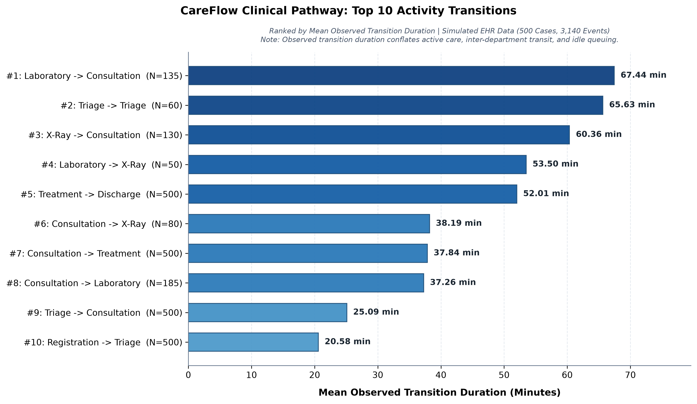

# CareFlow Clinical Pathway: Bottleneck Findings Report

- **Project:** CareFlow Clinical Pathway Analytics
- **Date:** October 28, 2026
- **Artifact:** `outputs/bottleneck_findings.md`
- **Related Visual Artifact:** [`outputs/bottleneck_analysis.png`](bottleneck_analysis.png)
- **Source Dataset:** [`outputs/bottleneck_analysis_summary.csv`](bottleneck_analysis_summary.csv) / [`outputs/dfg_transitions_summary.csv`](dfg_transitions_summary.csv)

---

## 1. Executive Summary & Objective

The objective of this bottleneck analysis is to identify and quantify operational delays across emergency department patient journeys using directly-follows graph (DFG) process mining. By evaluating elapsed durations between consecutive clinical activity milestones, the analysis highlights operational handoffs that represent the longest transitions in the pathway.

### Data Provenance & Synthetic Disclaimer
All analysis in this phase is conducted on simulated emergency department encounter records generated locally (`data/raw/hospital_events_simulated.csv`), representing the intended data flow for cloud ingestion into BigQuery (`careflow_raw.hospital_events_raw`) and staging transformations via dbt (`careflow_staging.stg_hospital_events`):
* **Cohort Scale:** 500 unique patient encounters (`case_id`).
* **Event Volume:** 3,140 discrete chronological event milestones.
* **Process Scope:** 7 clinical activities (`Registration`, `Triage`, `Consultation`, `Laboratory`, `X-Ray`, `Treatment`, `Discharge`).
* **Healthcare Data Integrity Notice:** This dataset contains **100% synthetic data** generated for educational process mining and data engineering demonstration. It contains **no real patient data (EHR/PHI)** and does not reflect actual clinical performance of any healthcare provider.
* **Pipeline Status Note:** The findings reported here reflect reproducible local process-mining analysis derived from canonical simulated inputs. Cloud warehouse ingestion and dbt transformations represent intended downstream architectures and should not be assumed as live-verified unless accompanied by authenticated query logs.

---

## 2. Top Five Observed Clinical Transitions

Transitions from the directly-follows graph were ranked descending by mean observed transition duration. The top five transitions account for the primary latency intervals in patient flow:

| Rank | Source Activity | Target Activity | Transition Count ($N$) | Mean Observed (min) | Median Observed (min) | Min Observed (min) | Max Observed (min) | Potential Operational Interpretation (Unmeasured) |
| :---: | :--- | :--- | :---: | :---: | :---: | :---: | :---: | :--- |
| **1** | **Laboratory** | **Consultation** | 135 | **67.44** | 67.00 | 42.00 | 95.00 | Diagnostic specimen processing & physician review |
| **2** | **Triage** | **Triage** | 60 | **65.63** | 64.50 | 40.00 | 88.00 | Emergency waiting queue reassessment loop |
| **3** | **X-Ray** | **Consultation** | 130 | **60.36** | 61.00 | 36.00 | 85.00 | Radiologic imaging acquisition & physician follow-up |
| **4** | **Laboratory** | **X-Ray** | 50 | **53.50** | 51.00 | 36.00 | 74.00 | Complex multi-diagnostic inter-department handoff |
| **5** | **Treatment** | **Discharge** | 500 | **52.01** | 52.00 | 27.00 | 80.00 | Post-treatment clinical observation & discharge admin |

The remaining five transitions exhibit shorter mean durations:
* **Rank 6:** `Consultation -> X-Ray` ($N=80$, Mean: **38.19 min**, Median: 39.00 min)
* **Rank 7:** `Consultation -> Treatment` ($N=500$, Mean: **37.84 min**, Median: 38.00 min)
* **Rank 8:** `Consultation -> Laboratory` ($N=185$, Mean: **37.26 min**, Median: 37.00 min)
* **Rank 9:** `Triage -> Consultation` ($N=500$, Mean: **25.09 min**, Median: 25.00 min)
* **Rank 10:** `Registration -> Triage` ($N=500$, Mean: **20.58 min**, Median: 20.00 min)

---

## 3. Operational & Clinical Interpretation

> **Note on Analytical Attribution:** The underlying event log records discrete milestone timestamps only (`Timestamp`). It does not measure sub-interval durations for internal department tasks. Consequently, clinical explanations—such as specimen processing, physician review, clinical deterioration, imaging report generation, patient transit, and discharge administration—represent *possible interpretations*, not facts directly measured by the event log.

### A. Diagnostic Processing & Physician Re-Evaluation Latency
The single longest observed transition in the analyzed dataset is **`Laboratory -> Consultation`** (Mean: **67.44 min**, Median: 67.00 min), followed by **`X-Ray -> Consultation`** (Mean: **60.36 min**, Median: 61.00 min):
* **Plausible Operational Context:** In hospital emergency operations, the interval between diagnostic completion and subsequent consultation may reflect several unmeasured components: specimen transit, centrifuge and automated chemistry analysis, radiologic image acquisition and radiologist reporting, and subsequent queue time awaiting an available physician to review results with the patient.
* **Analytical Interpretation:** While these diagnostic review handoffs represent the largest contributor to total encounter duration in diagnostic pathways (Variants 2, 3, and 4), the event log records only the two milestone endpoints. Whether latency stems from laboratory processing time, transport delays, or doctor availability cannot be established without sub-event tracking or laboratory information system (LIS) telemetry.

### B. Repeated Triage / Re-Triage Operational Loops
The self-loop **`Triage -> Triage`** ranks **2nd** across all transitions with an observed mean duration of **65.63 minutes** (Median: 64.50 min, Min: 40.00 min, Max: 88.00 min):
* **Prevalence:** Exactly 60 encounters undergo repeated triage (12.0% of the entire cohort, appearing in Variant 5 [$N=35$] and Variant 6 [$N=25$]).
* **Plausible Clinical Interpretation:** In emergency medicine literature, repeat triage commonly indicates suspected patient clinical deterioration, evolving symptom severity, or protocol-driven nursing reassessment during extended waiting room delays.
* **Data Logging Limitation:** The event log records only that a second `Triage` milestone occurred 65.63 minutes (mean) after the first. It does not measure whether clinical deterioration actually took place or whether reassessment was triggered by time-based clinical protocol. Nevertheless, this recurrence highlights a key operational audit focus for patient safety monitoring.

### C. Multi-Diagnostic Handoffs and Discharge Processing
* **`Laboratory -> X-Ray` (Rank 4, Mean: 53.50 min):** Occurs in multi-diagnostic Variant 4 encounters ($N=50$). A plausible interpretation is inter-department transport and queuing between diagnostic services, though physical transport duration is not independently logged.
* **`Treatment -> Discharge` (Rank 5, Mean: 52.01 min):** Present across all 500 patient encounters. Possible interpretations include post-treatment clinical observation (e.g., monitoring medication response or stabilizing vital signs), administrative discharge documentation, prescription reconciliation, and patient transport arrangement. The milestone data does not separate clinical recovery time from administrative exit processing.

---

## 4. Visual Artifact Reference

The findings are graphically summarized in the project visual artifact:
* **Artifact Path:** [`outputs/bottleneck_analysis.png`](bottleneck_analysis.png)
* **Description:** A high-resolution (300 DPI) horizontal bar chart illustrating all 10 observed transitions ranked by mean observed transition duration. Each bar is labeled with its exact mean duration in minutes and encounter volume ($N$), allowing clinical operations teams to compare diagnostic, administrative, and re-triage intervals at a glance.

---

## 5. Analytical Limitations & Healthcare Terminology Clarification

To maintain professional healthcare data analytics rigor, findings must be interpreted within the constraints of discrete event log structures:

1. **Observed Transition Duration vs. Pure Waiting Time:**
   * The analyzed event log records point-in-time milestone timestamps (`Timestamp`).
   * The elapsed duration between Activity $A$ and Activity $B$ represents **total observed transition duration**.
   * In the absence of discrete `start_timestamp` and `end_timestamp` tracking for each activity, this duration conflates:
     * Active clinical service delivery (e.g., specimen analysis, imaging acquisition, physical treatment).
     * Inter-department patient and specimen transit time.
     * Queue waiting time awaiting an available doctor, nurse, or exam room.
   * **Important Rule:** Observed transition times alone **do not** establish actual patient waiting times or confirmed clinical bottlenecks. Establishing true clinical bottlenecks requires queue-depth measurements, physical capacity modeling, or dual-timestamp tracking.
2. **Lack of Resource & Capacity Telemetry:**
   * The event log lacks bed occupancy logs, staffing ratios, physician shift schedules, and concurrent waiting room census data.
   * Variations in duration may reflect intentional clinical observation periods (e.g., scheduled post-medication monitoring) rather than operational failure.
3. **BigQuery Sandbox Expiration Policy:**
   * Tables and views in Google Cloud BigQuery Sandbox are subject to a default 60-day expiration policy from their creation date unless migrated to permanent storage or refreshed. Exact expiration timestamps depend on when cloud resources are physically provisioned and cannot be inferred from local process-mining artifacts.

---

## 6. Recommended Next Checks & Next Steps

Building upon these findings, the following analytical phases are recommended for Weeks 3 and 4:

1. **Dimensional Modeling (Star Schema Design):**
   * Structure star-schema analytical tables in BigQuery/dbt:
     * Fact table: `fact_patient_events` (event milestone, sequence, transition duration from previous event, cumulative duration).
     * Dimension tables: `dim_patient`, `dim_activity`, `dim_department`, `dim_pathway_variant`.
2. **Acuity & Severity Stratification:**
   * Segment `Triage -> Triage` and `Laboratory -> Consultation` intervals by patient triage severity score (Levels 1–5) to evaluate whether duration variations correlate with patient acuity.
3. **Power BI Dashboard Development:**
   * Ingest `outputs/bottleneck_analysis_summary.csv` and staging tables into Power BI.
   * Build interactive visual components:
     * Executive Overview: Cohort volume, average length of stay (ALOS), variant breakdown.
     * Bottleneck Drilldown: Distribution histograms for `Laboratory -> Consultation` and `Triage -> Triage`.
     * Re-Triage Audit: Dedicated safety dashboard tracking the 60 re-triage encounters.
4. **Normative Conformance Checking (Week 4):**
   * Perform token-replay conformance checking against hospital operational clinical guidelines to systematically flag out-of-order executions, unexpected loop-backs, and compliance violations.
