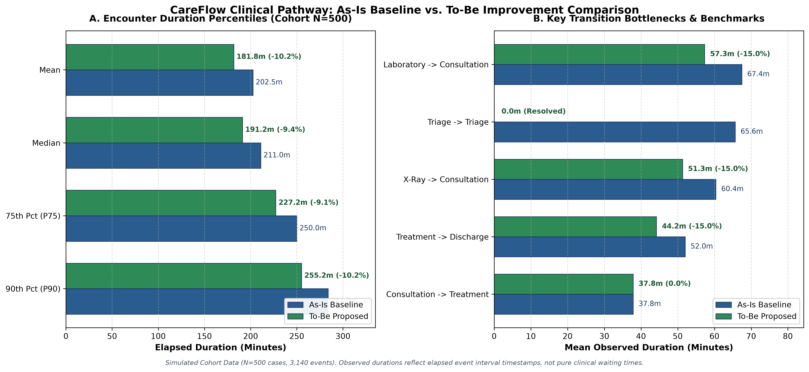

# CareFlow Clinical Pathway: As-Is vs. To-Be Improvement Report

- **Project:** CareFlow Clinical Pathway Analytics
- **Evaluation Date:** October 29, 2026
- **Artifact:** `outputs/pathway_improvement_report.md`
- **Related Artifacts:** [`outputs/pathway_improvement_comparison.csv`](pathway_improvement_comparison.csv), [`outputs/pathway_improvement_summary.json`](pathway_improvement_summary.json), [`outputs/pathway_improvement_comparison.png`](pathway_improvement_comparison.png)
- **Baseline Source:** `data/cleaned/stg_hospital_events.csv` (Simulated)

---

## 1. Executive Summary & Objective

This report delivers a reproducible comparative analysis between the observed **As-Is baseline** clinical pathway and an illustrative **To-Be operational improvement scenario** for emergency department patient encounters.

### Key Quantitative Findings
- **Cohort Size:** Evaluated 500 simulated patient encounters.
- **Mean Encounter Duration:** Reduced from **202.54 minutes** (~3.4 hrs) to **181.77 minutes** (~3.0 hrs), achieving a **-10.2% reduction** (-20.77 min average savings per encounter).
- **Median Encounter Duration:** Reduced from **211.00 minutes** to **191.18 minutes** (**-9.4% reduction**).
- **90th Percentile Stay:** Reduced from **284.00 minutes** to **255.18 minutes** (-28.82 min), meaningfully truncating extended length of stay.
- **Pathway Standardization:** Variant count decreased from **6** to **4** as encounters previously experiencing repeated triage successfully normalized into standard diagnostic pathways.

### Analytical & Clinical Boundaries
- **100% Synthetic Event Data:** The dataset contains simulated hospital records (500 cases, 3,140 events) and **no real patient Electronic Health Records (EHR) or Protected Health Information (PHI)**.
- **Operational Simulation, Not Clinical Claims:** Observed durations represent elapsed timestamps between recorded milestones, combining active clinical delivery, patient transport, administrative tasks, and waiting time. Reductions reflect hypothetical coordination improvements and do not guarantee or measure real-world clinical patient outcomes.
- **Clinical Safety Assumption:** The To-Be scenario removes repeated triage events as a hypothetical operational improvement. Simulated event data alone cannot determine whether reassessment is clinically necessary. Qualified hospital staff must validate this assumption before any real-world workflow change. Consultations, diagnostic activities, treatment, and discharge remain represented in the simulated pathways.

---

## 2. To-Be Scenario Design & Assumptions

**Scenario Name:** `Operational Coordination & Queue Optimization`

**Description:** Conservative illustrative scenario modeling: (1) hypothetical avoidance of repeated triage via queue coordination (an operational assumption subject to clinical validation), (2) an assumed 15% reduction in laboratory and radiology review turnaround parameters via automated stat-alerts, and (3) an assumed 15% reduction in discharge administration coordination. All reported improvements are simulated estimates, not measured real-world results.

### Operational Levers & Rationale
| Improvement Lever | Target Workflow Milestone | Modeled Mechanism | Baseline Mean | Modeled Change | Provenance |
| :--- | :--- | :--- | :---: | :---: | :---: |
| **Laboratory Coordination** | `Laboratory -> Consultation` | Automated electronic stat-lab alerts and dedicated physician review routing | 67.44 min | -15% | `ASSUMED_HYPOTHETICAL` |
| **X-Ray Coordination** | `X-Ray -> Consultation` | Digital PACS radiologist alert integration and electronic clinician sign-off | 60.36 min | -15% | `ASSUMED_HYPOTHETICAL` |
| **Treatment Coordination** | `Treatment -> Discharge` | Streamlined bedside discharge administration, electronic pharmacy routing, and transport coordination | 52.01 min | -15% | `ASSUMED_HYPOTHETICAL` |
| **Registration Coordination** | `Registration -> Triage` | Baseline intake maintained; optional self-service kiosk can be configured | 20.58 min | 0% | `ASSUMED_HYPOTHETICAL` |
| **Queue Management** | `Triage -> Triage` | Hypothetical assumption: proactive queue tracking bypasses repeated triage by expediting physician consultation; requires clinical validation | 65.63 min | -100.0% (Eliminated) | `SIMULATED_ESTIMATE` |

---

## 3. As-Is vs. To-Be Quantitative Comparison

### Cohort & Process Overview
| Metric Category | Metric Name | As-Is Baseline | To-Be Proposed | Absolute Delta | Relative Change (%) | Analytical Provenance |
| :--- | :--- | :---: | :---: | :---: | :---: | :--- |
| **Cohort Overview** | Total Evaluated Cases | 500 | 500 | +0 | +0.00% | `OBSERVED_BASELINE` |
| **Cohort Overview** | Total Recorded Events | 3140 | 3080 | -60 | -1.91% | `SIMULATED_ESTIMATE` |
| **Cohort Overview** | Clinical Pathway Variants | 6 | 4 | -2 | -33.33% | `SIMULATED_ESTIMATE` |

### Patient Encounter Duration Statistics (Minutes)
| Metric Name | Baseline (As-Is) | Proposed (To-Be) | Difference (Min) | Percent Change (%) | Operational Meaning |
| :--- | :---: | :---: | :---: | :---: | :--- |
| **Mean Encounter Duration** | 202.54 | 181.77 | -20.77 min | **-10.25%** | Average patient elapsed time from intake to discharge. |
| **Median Encounter Duration** | 211.00 | 191.18 | -19.82 min | **-9.39%** | Typical patient encounter elapsed duration (50th percentile). |
| **25th Percentile Duration (P25)** | 142.00 | 129.10 | -12.90 min | **-9.08%** | Lower quartile of encounter durations. |
| **75th Percentile Duration (P75)** | 250.00 | 227.25 | -22.75 min | **-9.10%** | Upper quartile of encounter durations. |
| **90th Percentile Duration (P90)** | 284.00 | 255.18 | -28.82 min | **-10.15%** | Extended stay cohort threshold (90th percentile). |
| **Minimum Encounter Duration** | 95.00 | 90.05 | -4.95 min | **-5.21%** | Shortest recorded encounter in the cohort. |
| **Maximum Encounter Duration** | 354.00 | 315.35 | -38.65 min | **-10.92%** | Longest recorded encounter in the cohort. |
| **Standard Deviation** | 62.44 | 55.77 | -6.67 min | **-10.68%** | Dispersion of encounter durations around the cohort mean. |

### Key Activity Transitions (Mean Elapsed Minutes)
| Transition Pair | Baseline Mean (Min) | Proposed Mean (Min) | Delta (Min) | Change (%) | Operational Assessment |
| :--- | :---: | :---: | :---: | :---: | :--- |
| `Consultation -> Laboratory (N=185->185)` | 37.26 | 37.26 | +0.00 min | +0.00% | Benchmark transition: baseline operational duration maintained without alteration. |
| `Consultation -> Treatment (N=500->500)` | 37.84 | 37.84 | +0.00 min | +0.00% | Benchmark transition: baseline operational duration maintained without alteration. |
| `Consultation -> X-Ray (N=80->80)` | 38.19 | 38.19 | +0.00 min | +0.00% | Benchmark transition: baseline operational duration maintained without alteration. |
| `Laboratory -> Consultation (N=135->135)` | 67.44 | 57.32 | -10.12 min | -15.01% | Targeted operational streamlining: Automated electronic stat-lab alerts and dedicated physician review routing. |
| `Laboratory -> X-Ray (N=50->50)` | 53.50 | 53.50 | +0.00 min | +0.00% | Benchmark transition: baseline operational duration maintained without alteration. |
| `Registration -> Triage (N=500->500)` | 20.58 | 20.58 | +0.00 min | +0.00% | Benchmark transition: baseline operational duration maintained without alteration. |
| `Treatment -> Discharge (N=500->500)` | 52.01 | 44.21 | -7.80 min | -15.00% | Targeted operational streamlining: Streamlined bedside discharge administration, electronic pharmacy routing, and transport coordination. |
| `Triage -> Consultation (N=500->500)` | 25.09 | 25.09 | +0.00 min | +0.00% | Benchmark transition: baseline operational duration maintained without alteration. |
| `Triage -> Triage (N=60->0)` | 65.63 | 0.00 | -65.63 min | -100.00% | Hypothetical queue-management assumption: repeated triage bypassed as patients route directly to consultation; subject to clinical validation. |
| `X-Ray -> Consultation (N=130->130)` | 60.36 | 51.31 | -9.05 min | -14.99% | Targeted operational streamlining: Digital PACS radiologist alert integration and electronic clinician sign-off. |

---

## 4. Pathway Variant Distribution Shift

A critical process mining insight is the consolidation of clinical pathways when operational friction is mitigated:

| Variant Rank | Clinical Pathway Sequence | As-Is Cases | As-Is Share (%) | To-Be Cases | To-Be Share (%) | Shift Explanation |
| :---: | :--- | :---: | :---: | :---: | :---: | :--- |
| **1** | `Registration -> Triage -> Consultation -> Treatment -> Discharge` | 200 | 40.0% | 235 | 47.0% | Expanded cohort (+35 cases) absorbing normalized re-triage encounters. |
| **2** | `Registration -> Triage -> Consultation -> Laboratory -> Consultation -> Treatment -> Discharge` | 110 | 22.0% | 135 | 27.0% | Expanded cohort (+25 cases) absorbing normalized re-triage encounters. |
| **3** | `Registration -> Triage -> Consultation -> X-Ray -> Consultation -> Treatment -> Discharge` | 80 | 16.0% | 80 | 16.0% | Pathway structure unchanged; durations streamlined. |
| **4** | `Registration -> Triage -> Consultation -> Laboratory -> X-Ray -> Consultation -> Treatment -> Discharge` | 50 | 10.0% | 50 | 10.0% | Pathway structure unchanged; durations streamlined. |
| **5** | `Registration -> Triage -> Triage -> Consultation -> Treatment -> Discharge` | 35 | 7.0% | 0 | 0.0% | Eliminated variant: re-triage delay resolved into standard non-repeating pathway. |
| **6** | `Registration -> Triage -> Triage -> Consultation -> Laboratory -> Consultation -> Treatment -> Discharge` | 25 | 5.0% | 0 | 0.0% | Eliminated variant: re-triage delay resolved into standard non-repeating pathway. |

---

## 5. Visual Comparison Chart

The comparative chart illustrates the quantitative compression of encounter durations and key transition bottlenecks:

- **Panel A (Encounter Duration Distributions):** Highlights the systematic left-shift in duration percentiles, particularly truncating high-acuity/high-delay encounters (P90: 284.0m -> 255.2m).
- **Panel B (Bottleneck Transitions):** Demonstrates the operational effect of diagnostic result alert integration and re-triage avoidance against baseline benchmarks.

---

## 6. Analytical Limitations & Missing Data

To maintain rigorous data integrity, the following limitations must be noted:
1. **Elapsed Time vs. Pure Waiting Time:**
   - The event log records discrete event milestone timestamps. It cannot separate queue waiting time from active clinical care (e.g. physician physical examination, specimen processing, medication infusion).
2. **Fixed Parameter Simulation:**
   - Proposed percentage reductions (15%) are conservative operational estimates. Real clinical environments exhibit stochastic arrival spikes and dynamic staffing shortages.
3. **Missing Clinical Variables:**
   - The dataset lacks clinical acuity scores (ESI Levels 1–5), patient vital signs, lab panel complexities, and bed occupancy rates. Real-world implementation must stratify improvements across clinical urgency tiers.

---

## 7. Recommended Next Steps for Hospital Operations

1. **Pilot Automated Diagnostic Notifications:**
   - Implement direct-to-physician electronic alerts in the Emergency Department EHR for completed critical lab panels and X-ray reads.
2. **Nurse Triage Queue Management System:**
   - Deploy a digital dashboard tracking time-since-triage to alert charge nurses when waiting room patients approach re-assessment thresholds, enabling proactive physician fast-tracking.
3. **Bedside Discharge Medication Delivery:**
   - Transition discharge medication delivery directly to the bedside to compress the 52-minute Treatment -> Discharge transition.
4. **Power BI Dashboard Integration:**
   - Import `outputs/pathway_improvement_comparison.csv` into the CareFlow Power BI reporting layer for executive scenario modeling.
