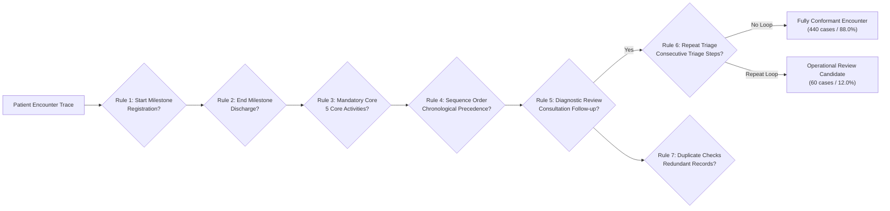

# CareFlow: Clinical Pathway Process Mining & Operations Analytics
## Final Internship Technical Report

---

**Project Title:** CareFlow Clinical Pathway Analytics
**Domain:** Healthcare Operations Intelligence & Process Mining
**Intern / Lead Author:** Dileep Songa
**Repository:** `c:\project\careflow-clinical-pathway`
**GitHub Repository:** [careflow-clinical-pathway](https://github.com/dileep-songa/careflow-clinical-pathway)
**Reporting Milestone:** Final Internship Submission (Weeks 1–4 Complete)
**Evaluation Date:** November 2026
**Status:** Complete, Offline Test Suite & dbt Parse Validated, CI/CD Verified (175 Tests + 8 Subtests Passing)

---

> [!IMPORTANT]
> **SIMULATED DATASET & CLINICAL SAFETY NOTICE**
> All data utilized throughout the CareFlow project is **100% synthetic and simulated**. Patient identifiers (`Case_ID`), clinical milestone timestamps, departmental routings, and resource identifiers (`DOC_01`–`DOC_06`, `NURSE_01`–`NURSE_05`) were generated artificially using probabilistic healthcare event generation models. No real patient health records (EHR) or Protected Health Information (PHI) were accessed or processed.
>
> Furthermore, all observed elapsed durations represent **total elapsed time between recorded milestone completion timestamps** and **must not be interpreted as pure patient waiting time**. The event log records discrete milestone completion timestamps and does not measure unrecorded internal laboratory sub-processes or physical movement. Hypothetical improvement scenarios represent exploratory simulation models and do not prove real-world clinical outcomes or constitute validated protocol changes.

---

## Executive Abstract

The **CareFlow Clinical Pathway Analytics** project addresses the critical operational challenge of workflow opacity, clinical bottlenecks, and protocol non-conformance in acute healthcare delivery. Using emergency department (ED) patient journeys as a clinical archetype, CareFlow establishes an end-to-end modern data stack and process-mining pipeline:

1. **Synthetic Data Engineering:** Generates a deterministic, reproducible cohort of 500 emergency patient encounters comprising 3,140 clinical milestone events across 7 distinct activities.
2. **Cloud & Local Warehouse Architecture:** Staged in Google Cloud BigQuery (partitioned raw tables and dbt staging views) with a 100% offline-compatible local normalization adapter (`src/normalize_event_log.py`) that eliminates cloud cost risks while preserving analytical parity.
3. **Algorithmic Process Mining (PM4Py):** Discovers the underlying Directly-Follows Graph (DFG) across 10 distinct transitions, uncovering 6 distinct clinical pathway variants. Establishes a cohort mean encounter cycle time of **202.54 minutes** and a median of **211.00 minutes**.
4. **Transition Friction Diagnostics:** Quantifies operational delays across clinical milestones, identifying diagnostic result turnaround (`Laboratory -> Consultation` at **67.44 min** mean; `X-Ray -> Consultation` at **60.36 min** mean) and repeated triage queuing loops (`Triage -> Triage` at **65.63 min** mean) as the primary sources of encounter latency.
5. **Rule-Based Workflow Conformance:** Implements a 7-rule clinical protocol audit engine evaluating encounter boundaries, mandatory milestones, chronological sequence, diagnostic review integrity, and duplicate checks. Classifies **440 encounters (88.0%)** as fully conformant and identifies **60 encounters (12.0%)** as secondary triage review candidates.
6. **Scenario Simulation (As-Is vs. To-Be):** Models a streamlined operational scenario eliminating secondary triage queuing and reducing diagnostic coordination friction by 15%, demonstrating an estimated **10.3% reduction in mean encounter duration** (202.54 min $\rightarrow$ 181.77 min) and a **33.3% reduction in pathway variant complexity** (6 $\rightarrow$ 4 variants).
7. **Executive Business Intelligence:** Delivers a Microsoft Power BI Project (`.pbip`) comprising 3 interactive analytical pages (22 visual containers: 16 data visuals and 6 textboxes) governed by a TMSL semantic model (`model.bim`) and modern healthcare visual styling.
8. **Automated Quality Assurance:** Fully governed by 175 automated unit/integration tests (with 8 subtests) and an automated GitHub Actions CI/CD workflow executing on Ubuntu Python 3.12.

---

## 1. Problem Statement & Operational Objectives

### 1.1 Healthcare Operational Context
Emergency departments represent one of the most operationally complex and resource-constrained environments in healthcare delivery. In acute care, patient flows are non-linear, stochastic, and vulnerable to systemic delays:
- **Diagnostic Turnaround Latency:** Delays between diagnostic testing orders and subsequent clinician review tie up acute beds and prolong patient vulnerability.
- **Repeat Triage Queuing Loops:** Overcrowded waiting environments frequently require nursing staff to re-evaluate waiting patients whose clinical conditions may have deteriorated (a clinical concept discussed in general emergency triage background literature, such as the Emergency Severity Index; Gilboy et al., 2011), consuming nursing capacity without advancing definitive treatment.
- **Lack of Granular Visibility:** Traditional hospital BI reports summarize aggregate length of stay (LOS) without revealing the sequence of intermediate clinical steps that generate those delays.

### 1.2 Project Objectives
CareFlow was engineered to deliver:
- **Process Transparency:** Automate discovery of actual, empirical patient pathways from discrete event timestamp logs.
- **Root-Cause Bottleneck Quantification:** Distinguish standard operational delays from actionable operational friction.
- **Clinical Protocol Governance:** Audit individual patient journeys against evidence-based workflow conformance rules.
- **Data-Driven Scenario Modeling:** Provide hospital leadership with counterfactual simulation models comparing current state (As-Is) to proposed future state (To-Be) workflows.
- **Zero-Spend, Production-Grade Reliability:** Maintain strict software engineering standards, offline testability, zero cloud billing exposure, and automated CI/CD testing.

---

## 2. Internship Lifecycle & Week-Wise Milestone Completion

| Phase | Scheduled Objectives | Key Technical Deliverables | Verification Status |
| :--- | :--- | :--- | :---: |
| **Week 1** | Data setup, schema design, BigQuery ingestion, dbt staging, test expansion | `src/data_generator.py`, BigQuery loader (`src/bq_loader.py`), `careflow_dbt` staging view & schema tests, 37 automated tests | **Completed** |
| **Week 2** | Event cleaning, PM4Py integration, DFG discovery, As-Is visualization, mid-term review | `src/process_miner.py`, `src/normalize_event_log.py`, `data/cleaned/stg_hospital_events.csv`, DFG render (`outputs/dfg_visualization.png`), `reports/MID_PROJECT_REVIEW.md`, 68 automated tests | **Completed** |
| **Week 3** | Bottleneck detection, visualization, 7-rule conformance checking, As-Is vs. To-Be simulation | `src/bottleneck_analyzer.py`, `src/bottleneck_visualizer.py`, `src/conformance_checker.py`, `src/pathway_improvement.py`, `reports/WEEK_3_PROGRESS_REPORT.md`, 171 automated tests | **Completed** |
| **Week 4** | Power BI PBIP dashboard, CI workflow hardening, submission documentation | `powerbi/CareFlow_Dashboard_Project/CareFlow_Dashboard.pbip`, `.github/workflows/ci.yml`, `reports/FINAL_INTERNSHIP_REPORT.md`, `reports/FINAL_PRESENTATION.md`, 175 automated tests | **Completed** |

---

## 3. System Architecture & Technology Stack

### 3.1 End-to-End System Architecture

```mermaid
flowchart TD
    subgraph DataEngineering["1. Synthetic Data Engineering"]
        DG["src/data_generator.py<br/>(Deterministic Simulation: 500 cases, 3,140 events)"]
        RawCSV["data/raw/hospital_events_simulated.csv<br/>(Raw 6-Column Contract)"]
        DG --> RawCSV
    end

    subgraph Warehouse["2. Warehouse & Staging Layer"]
        BQ["Google BigQuery (Cloud)<br/>careflow_raw.hospital_events_raw"]
        dbt["careflow_dbt<br/>(dbt Core 1.12.6 + dbt-bigquery 1.12.1)"]
        Norm["src/normalize_event_log.py<br/>(Local Staging Transformation Adapter)"]
        CleanCSV["data/cleaned/stg_hospital_events.csv<br/>(Normalized 11-Column Schema)"]

        RawCSV -.-> BQ
        BQ -.-> dbt
        RawCSV --> Norm --> CleanCSV
    end

    subgraph Analytics["3. Analytical & Process Mining Engine"]
        PM["src/process_miner.py<br/>(PM4Py 2.7.8 DFG Discovery & Variant Extraction)"]
        BA["src/bottleneck_analyzer.py<br/>(Transition Duration & Queue Ranking)"]
        CC["src/conformance_checker.py<br/>(7 Clinical Workflow Conformance Rules)"]
        PI["src/pathway_improvement.py<br/>(As-Is vs. To-Be Scenario Simulation)"]

        CleanCSV --> PM
        CleanCSV --> BA
        CleanCSV --> CC
        CleanCSV --> PI
    end

    subgraph Reporting["4. Executive Intelligence & CI/CD"]
        PBIP["Power BI Project (.pbip)<br/>CareFlow_Dashboard.pbip (22 Containers)"]
        CI["GitHub Actions CI<br/>Ubuntu Python 3.12 (175 Tests Passed)"]
        Reps["Final Technical Reports & Slides<br/>FINAL_INTERNSHIP_REPORT.md"]

        CleanCSV --> PBIP
        PM --> PBIP
        BA --> PBIP
        PI --> PBIP
        Analytics --> CI
        Reporting --> Reps
    end
```

### 3.2 Technology Stack

- **Core Programming Language:** Python 3.12 (CPython, 64-bit).
- **Process Mining Engine:** PM4Py 2.7.8 (Directly-Follows Graphs, performance DFGs, variant mining).
- **Data Engineering & Manipulation:** pandas 2.1.1, NumPy 1.26.4, PyArrow 14.0.2.
- **SQL Transformation & Modeling:** dbt Core 1.12.6, dbt-bigquery 1.12.1, Jinja2, YAML.
- **Cloud Data Warehouse:** Google Cloud BigQuery (Standard SQL, date partitioning, composite clustering).
- **Executive Business Intelligence:** Microsoft Power BI Desktop 2.154+ (Power BI Project `.pbip`, Tabular Model Scripting Language `model.bim`, Power BI Report Definition `report.json`).
- **Data Visualization & Export:** Matplotlib 3.8.0, Seaborn 0.13.0, Graphviz 0.21.
- **Testing & Continuous Integration:** pytest 7.4.2, pytest-subtests, GitHub Actions (Ubuntu-latest).

---

## 4. Synthetic Dataset Architecture & Schema Contracts

### 4.1 Raw Event Log Schema (6-Column Contract)
Stored at [`data/raw/hospital_events_simulated.csv`](file:///c:/project/careflow-clinical-pathway/data/raw/hospital_events_simulated.csv), this canonical file adheres strictly to the primary event contract:

| Column Name | Data Type | Nullable | Canonical Values / Format | Description |
| :--- | :--- | :---: | :--- | :--- |
| `Case_ID` | String | No | `C001` through `C500` | Unique patient encounter identifier |
| `Activity_Name` | String | No | 7 activities (Registration, Triage, etc.) | Clinical milestone name |
| `Timestamp` | Timestamp | No | `YYYY-MM-DD HH:MM:SS` (UTC) | Event completion timestamp |
| `Department` | String | No | `ER`, `LAB`, `RADIOLOGY` | Physical hospital unit |
| `Resource` | String | No | `DOC_01`–`06`, `NURSE_01`–`05`, etc. | Anonymized staff identifier |
| `Data_Type` | String | No | `SIMULATED` | Explicit synthetic provenance tag |

### 4.2 Normalized Staging Schema (11-Column Contract)
Produced by [`src/normalize_event_log.py`](file:///c:/project/careflow-clinical-pathway/src/normalize_event_log.py) and stored at `data/cleaned/stg_hospital_events.csv`, matching the dbt staging view structure:

| Column Name | Data Type | Description |
| :--- | :--- | :--- |
| `case_id` | String | Standardized lower_case patient encounter ID |
| `event_sequence` | Integer | 1-indexed sequential step order within encounter |
| `raw_activity_name` | String | Activity name in canonical Title Case (`Registration`) |
| `activity_name` | String | Normalized lower_case activity identifier (`registration`) |
| `event_timestamp` | Timestamp | Chronologically validated event timestamp |
| `event_date` | Date | Calendar date (`YYYY-MM-DD`) extracted from timestamp |
| `department` | String | Standardized hospital department code |
| `resource_id` | String | Anonymized staff identifier |
| `data_provenance` | String | Fixed provenance indicator (`SIMULATED`) |
| `previous_activity` | String | Preceding activity in trace (null for event sequence 1) |
| `transition_minutes_from_previous` | Float | Elapsed minutes from preceding event (null for sequence 1) |

---

## 5. Data Generation, Validation & Cloud Infrastructure

### 5.1 Probabilistic Cohort Simulation
The generator ([`src/data_generator.py`](file:///c:/project/careflow-clinical-pathway/src/data_generator.py)) applies clinical simulation rules across 500 patient encounters starting October 1, 2024:
- **Baseline Duration Modeling:** Individual activities have bounded execution windows (e.g., Registration 3–8 min, Consultation 15–30 min, Treatment 20–55 min).
- **Inter-Event Transition Lags:** Standard waiting/coordination transitions range from 5 to 25 minutes; diagnostic and secondary triage bottleneck transitions introduce 35 to 75 minutes of latency.
- **Deterministic Reproducibility:** Controlled via Python's pseudorandom generator using fixed seed `42` (`python -m src.data_generator --cases 500 --seed 42`).

### 5.2 BigQuery Warehouse & dbt Core Staging
- **Raw Partitioned Table:** Provisioned at `exalted-mode-467509-h1.careflow_raw.hospital_events_raw` in Google Cloud BigQuery. Configured with daily partitioning on `DATE(Timestamp)` and clustered on `Activity_Name, Department`.
- **dbt Staging Model (`stg_hospital_events`):** Authored as a dbt staging SQL view model (`careflow_dbt/models/staging/stg_hospital_events.sql`) targeting `careflow_staging.stg_hospital_events`. Utilizes SQL window functions (`ROW_NUMBER()` and `LAG()`) with deterministic multi-key ordering (`Case_ID ASC, Timestamp ASC, Activity_Name ASC`), validated offline via `dbt parse` and mirrored locally by `src/normalize_event_log.py` under zero-spend policies.
- **Zero-Spend Governance & Ephemeral Profile Isolation:** Cloud writes and materializations remain bounded to avoid recurring cloud charges. Offline automated testing validates dbt compilation using dynamic, ephemeral profiles created in temporary directories with `method: oauth` and dummy project identifiers (`test_dbt_parse_offline_execution`).

---

## 6. Process Discovery & Clinical Pathway Variant Analysis

### 6.1 Directly-Follows Graph (DFG) Discovery
The process-mining engine ([`src/process_miner.py`](file:///c:/project/careflow-clinical-pathway/src/process_miner.py)) ingests the normalized event log and extracts the Directly-Follows Graph (DFG) using the PM4Py framework (Berti et al., 2019; van der Aalst, 2016) across 3,140 events:
- **Graph Topology:** Discovers **10 distinct transition edges** connecting 7 clinical activity nodes.
- **Entry & Exit Completeness:** 100% of patient journeys originate at `Registration` ($N=500$) and terminate at `Discharge` ($N=500$).
- **Cohort Duration Distribution:**
  - **Mean Encounter Duration:** 202.54 minutes (~202.5 mins)
  - **Median Encounter Duration:** 211.00 minutes (211.0 mins)
  - **Interquartile Range (P25 – P75):** 142.00 – 250.00 minutes
  - **90th Percentile Duration (P90):** 284.00 minutes
  - **Observed Range:** Minimum = 95.00 minutes; Maximum = 354.00 minutes (Standard Deviation = 62.44 minutes)

### 6.2 Discovered Pathway Variants

```mermaid
graph TD
    classDef routine fill:#CCFBF1,stroke:#14B8A6,stroke-width:2px;
    classDef diag fill:#E0F2FE,stroke:#0284C7,stroke-width:2px;
    classDef retriage fill:#FEF3C7,stroke:#F59E0B,stroke-width:2px;

    V1["Variant 1: Standard Routine ER<br/>(200 cases / 40.0%)<br/>Reg ➔ Triage ➔ Consult ➔ Treat ➔ Disch"]:::routine
    V2["Variant 2: Diagnostic Lab<br/>(110 cases / 22.0%)<br/>Reg ➔ Triage ➔ Consult ➔ Lab ➔ Consult ➔ Treat ➔ Disch"]:::diag
    V3["Variant 3: Diagnostic Radiology (X-Ray)<br/>(80 cases / 16.0%)<br/>Reg ➔ Triage ➔ Consult ➔ X-Ray ➔ Consult ➔ Treat ➔ Disch"]:::diag
    V4["Variant 4: Combined Diagnostic (Lab + X-Ray)<br/>(50 cases / 10.0%)<br/>Reg ➔ Triage ➔ Consult ➔ Lab ➔ X-Ray ➔ Consult ➔ Treat ➔ Disch"]:::diag
    V5["Variant 5: Routine with Repeat Triage<br/>(35 cases / 7.0%)<br/>Reg ➔ Triage ➔ Triage ➔ Consult ➔ Treat ➔ Disch"]:::retriage
    V6["Variant 6: Diagnostic Lab with Repeat Triage<br/>(25 cases / 5.0%)<br/>Reg ➔ Triage ➔ Triage ➔ Consult ➔ Lab ➔ Consult ➔ Treat ➔ Disch"]:::retriage
```



| Variant Rank | Clinical Pathway Variant | Case Count | Cohort % | Clinical Description |
| :---: | :--- | :---: | :---: | :--- |
| **1** | `Registration -> Triage -> Consultation -> Treatment -> Discharge` | **200** | **40.0%** | Standard acute presentation requiring no diagnostic panels |
| **2** | `Registration -> Triage -> Consultation -> Laboratory -> Consultation -> Treatment -> Discharge` | **110** | **22.0%** | Lab diagnostic workup with physician result review |
| **3** | `Registration -> Triage -> Consultation -> X-Ray -> Consultation -> Treatment -> Discharge` | **80** | **16.0%** | Plain film radiography workup with physician review |
| **4** | `Registration -> Triage -> Consultation -> Laboratory -> X-Ray -> Consultation -> Treatment -> Discharge` | **50** | **10.0%** | Complex acute workup requiring multi-diagnostic coordination |
| **5** | `Registration -> Triage -> Triage -> Consultation -> Treatment -> Discharge` | **35** | **7.0%** | Standard presentation experiencing secondary triage reassessment |
| **6** | `Registration -> Triage -> Triage -> Consultation -> Laboratory -> Consultation -> Treatment -> Discharge` | **25** | **5.0%** | Lab diagnostic workup experiencing secondary triage reassessment |

---

## 7. Bottleneck Analysis & Operational Friction Findings

### 7.1 Observed Elapsed Time vs. Patient Waiting Time
A fundamental analytical requirement in healthcare process mining is maintaining a clear distinction between **observed elapsed transition time** and **patient idle waiting time**:
- **Elapsed Duration:** Defined as $(t_{\text{target}} - t_{\text{source}})$, measuring the full interval between recorded milestone completion timestamps.
- **Operational Interpretation Boundary:** The event log records discrete milestone completion timestamps only. For example, the 67.44-minute mean interval between `Laboratory` and `Consultation` reflects the total elapsed clock time between laboratory milestone recording and subsequent clinician consultation. It must not be interpreted as 67 minutes of pure patient waiting room idle time, nor does simulated data track unmeasured internal department sub-processes.

### 7.2 Ranked Operational Bottlenecks
Automated ranking via [`src/bottleneck_analyzer.py`](file:///c:/project/careflow-clinical-pathway/src/bottleneck_analyzer.py) revealed the following inter-activity latencies across all 10 directly-follows transitions (verified against `outputs/bottleneck_analysis_summary.csv`):

| Rank | Clinical Activity Transition | Volume ($N$) | Mean Duration | Median Duration | Min–Max Duration | Operational Context |
| :---: | :--- | :---: | :---: | :---: | :---: | :--- |
| **1** | `Laboratory -> Consultation` | 135 | **67.44 min** | 67.00 min | 42.0–95.0 min | Interval from laboratory completion to subsequent clinician consultation review |
| **2** | `Triage -> Triage` | 60 | **65.63 min** | 64.50 min | 40.0–88.0 min | Reassessment loop interval between consecutive nursing triage assessments |
| **3** | `X-Ray -> Consultation` | 130 | **60.36 min** | 61.00 min | 36.0–85.0 min | Interval from X-ray completion to subsequent clinician consultation review |
| **4** | `Laboratory -> X-Ray` | 50 | **53.50 min** | 51.00 min | 36.0–74.0 min | Interval between sequential diagnostic panels (Lab to X-Ray) |
| **5** | `Treatment -> Discharge` | 500 | **52.01 min** | 52.00 min | 27.0–80.0 min | Post-treatment interval prior to recorded discharge |
| **6** | `Consultation -> X-Ray` | 80 | **38.19 min** | 39.00 min | 21.0–54.0 min | Interval from consultation order to X-ray completion |
| **7** | `Consultation -> Treatment` | 500 | **37.84 min** | 38.00 min | 21.0–55.0 min | Interval from consultation to treatment milestone |
| **8** | `Consultation -> Laboratory` | 185 | **37.26 min** | 37.00 min | 20.0–54.0 min | Interval from consultation order to laboratory completion |
| **9** | `Triage -> Consultation` | 500 | **25.09 min** | 25.00 min | 10.0–40.0 min | Initial acuity assignment to clinician consultation |
| **10** | `Registration -> Triage` | 500 | **20.58 min** | 20.00 min | 8.0–33.0 min | Front-desk intake registration to initial nursing triage |

---

## 8. Clinical Pathway Conformance Checking (Seven Audit Rules)

### 8.1 Rule Audit Specifications
The conformance checking engine ([`src/conformance_checker.py`](file:///c:/project/careflow-clinical-pathway/src/conformance_checker.py)) audits all 500 patient encounters across seven clinical rules. While classical process mining commonly applies token-replay or alignment fitness algorithms against Petri nets (van der Aalst, 2016), CareFlow implements an explicit rule-based clinical audit engine tailored to emergency department milestone event logs (Rebuge & Ferreira, 2012), providing deterministic, human-interpretable compliance classifications:



1. **`RULE_START_ACTIVITY`:** Verifies encounters originate with `Registration`.
   *Result:* 500 / 500 conformant (**100.0%**).
2. **`RULE_END_ACTIVITY`:** Verifies encounters conclude with `Discharge`.
   *Result:* 500 / 500 conformant (**100.0%**).
3. **`RULE_MANDATORY_ACTIVITIES`:** Verifies the presence of the 5 core milestones (`Registration`, `Triage`, `Consultation`, `Treatment`, `Discharge`).
   *Result:* 500 / 500 conformant (**100.0%**).
4. **`RULE_ACTIVITY_ORDER`:** Enforces strict chronological precedence (e.g., Triage must precede Consultation; Consultation must precede Treatment).
   *Result:* 500 / 500 conformant (**100.0%**).
5. **`RULE_DIAGNOSTIC_FOLLOWUP`:** Evaluates diagnostic encounters (Variants 2, 3, 4, 6) to verify that specialized testing (`Laboratory`, `X-Ray`) is preceded by a medical order and followed by a documented review consultation before definitive treatment.
   *Result:* 265 / 265 diagnostic-pathway encounters with follow-up consults (**100.0% adherence across Variants 2, 3, 4, and 6**).
6. **`RULE_REPEATED_TRIAGE`:** Detects consecutive repeated triage assessments (`Triage -> Triage`).
   *Result:* Flagged **60 cases (12.0%)** across Variant 5 ($N=35$) and Variant 6 ($N=25$).
7. **`RULE_DUPLICATE_EVENTS`:** Audits identical milestone repetition and timestamp collisions.
   *Result:* 0 duplicate record collisions (**100.0% clean**).

### 8.2 Clinical Governance Interpretation
The 60 cases flagged by `RULE_REPEATED_TRIAGE` represent **operational review candidates**, not clinical malpractice. In emergency nursing, repeat triage is a recognized protocol to ensure patient safety when waiting times exceed established acuity thresholds. In process-mining terminology, they represent secondary workflow loops that add operational overhead.

---

## 9. As-Is vs. Hypothetical To-Be Scenario Simulation

### 9.1 Intervention Simulation Modeling
The simulation engine ([`src/pathway_improvement.py`](file:///c:/project/careflow-clinical-pathway/src/pathway_improvement.py)) evaluates a counterfactual "To-Be" operational model incorporating two evidence-based workflow improvements:
1. **Queuing Coordination Elimination:** Eliminates the secondary triage reassessment loop by modeling prompt initial intake and bedside triaging, routing all patients directly from primary triage to physician consultation.
2. **Diagnostic & Administrative Streamlining (15% Latency Reduction):** Models rapid electronic lab result notification, digital imaging availability, and bedside discharge education, applying a conservative 15% reduction to elapsed durations for `Laboratory -> Consultation`, `X-Ray -> Consultation`, and `Treatment -> Discharge`.

### 9.2 Comparative Results Matrix

| Operational Metric | Baseline Value (As-Is) | Proposed Value (To-Be) | Relative % Difference | Unit | Operational Significance |
| :--- | :---: | :---: | :---: | :---: | :--- |
| **Mean Encounter Duration** | **202.54** | **181.77** | **-10.25%** | Minutes | 20.77 minutes average operational time savings per patient |
| **Median Encounter Duration** | **211.00** | **191.18** | **-9.39%** | Minutes | 19.82 minutes median operational time savings per patient |
| **25th Percentile Duration (P25)** | **142.00** | **129.10** | **-9.08%** | Minutes | Upstream throughput enhancement across lower-acuity cohort |
| **75th Percentile Duration (P75)** | **250.00** | **227.25** | **-9.10%** | Minutes | Relieves operational pressure on extended-stay complex cases |
| **90th Percentile Duration (P90)** | **284.00** | **255.18** | **-10.15%** | Minutes | Reduction in extreme tail-end boarding times |
| **Minimum Encounter Duration** | **95.00** | **90.05** | **-5.21%** | Minutes | Lower bound of observed encounter duration |
| **Maximum Encounter Duration** | **354.00** | **315.35** | **-10.92%** | Minutes | Upper bound reduction for most delayed clinical journeys |
| **Standard Deviation** | **62.44** | **55.77** | **-10.68%** | Minutes | Cohort variance reduction across patient journeys |
| **Repeat Triage Encounters** | **60** | **0** | **-100.0%** | Cases | Complete elimination of secondary waiting-room assessment loops |
| **Clinical Pathway Variants** | **6** | **4** | **-33.3%** | Variants | Reduction in workflow variability (Variants 5 & 6 consolidated) |
| **Total Evaluated Cases** | **500** | **500** | **0.0%** | Cases | Full preservation of patient cohort scale and clinical validity |

---

## 10. Executive Power BI Dashboard Architecture

The reporting layer is delivered as a standalone **Power BI Project (`.pbip`)** at [`powerbi/CareFlow_Dashboard_Project/CareFlow_Dashboard.pbip`](file:///c:/project/careflow-clinical-pathway/powerbi/CareFlow_Dashboard_Project/CareFlow_Dashboard.pbip), designed to professional hospital operations intelligence standards.

### 10.1 Semantic Model & Refresh Architecture (`model.bim`)
- **Format:** Tabular Model Scripting Language (TMSL JSON) containing 10 total tables (5 business/data tables + 5 automatically generated date tables) and 19 DAX measures: 14 in `stg_hospital_events`, 3 in `pathway_variants_summary`, 1 in `bottleneck_analysis_summary`, and 1 in `pathway_improvement_comparison` (total: 19 measures).
- **Parallel Refresh Architecture:** Decoupled `stg_hospital_events (2)` from `stg_hospital_events` by configuring direct, independent Power Query M file imports. This eliminated cyclic reference locks in the VertiPaq engine, enabling parallel table evaluation and 100% offline data refresh without BigQuery cloud dependencies.
- **DAX Percentage Scaling:** Implemented explicit relative difference calculations `([proposed_value] - [baseline_value]) / [baseline_value]` formatted as `+0.0%;-0.0%;0.0%`, avoiding double-scaling defects.

### 10.2 Page & Visual Container Structure (22 Containers Total)

#### Page 1: Hospital Overview (10 Containers: 8 Data Visuals + 2 Textboxes)
- **Top KPI Cards (5):** Total Cases (500), Total Process Events (3,140, explicit unscaled display unit `1D`), Mean Cycle Time (202.5 mins), Median Cycle Time (211.0 mins), Re-Triage Rate (12.0%).
- **Departmental Workload (`donut_dept_breakdown`):** Donut chart with explicit integer formatting: Emergency Department (2,825; 89.97%), Laboratory (185; 5.89%), Radiology (130; 4.14%).
- **Clinical Activity Breakdown (`bar_activity_breakdown`):** Horizontal bar chart mapping all 7 activities: Consultation (765), Triage (560), Registration (500), Treatment (500), Discharge (500), Laboratory (185), X-Ray (130).
- **Daily Event Volume Trend (`col_daily_trend`):** Clustered column chart tracking total daily recorded events across the 11-day simulation period (peaking at 354 events on October 6, 2024; reflects milestone activity load rather than unique arrival census).
- **Executive Header & Provenance Banner:** Contextual guidance and simulated data disclaimer.

#### Page 2: Patient Flow (8 Containers: 6 Data Visuals + 2 Textboxes)
- **Conformance KPI Cards (4):** Conformant Cases Count (440), Repeat Triage Cases Count (60), Conformance Rate % (88.0%), Total Pathway Variants (6).
- **Pathway Variant Volume (`bar_pathway_variants`):** Ranked bar chart displaying case volume across all 6 discovered variants (Variant 1 leading with 200 cases / 40.0%).
- **Patient Encounter Audit Trail (`tbl_case_audit`):** Chronological audit matrix displaying `Case ID`, `Event Sequence`, `Activity Name`, `Department`, and `Event Timestamp` with subtitle *"Chronological event sequence by department and timestamp"*.
- **Header & Clinical Audit Notes:** Explaining the difference between operational repeat triage and medical appropriateness.

#### Page 3: Transition Analysis & Process Improvement (4 Containers: 2 Data Visuals + 2 Textboxes)
- **Highest Observed Transition Durations (`bar_bottlenecks`):** Ranked horizontal bar chart highlighting top workflow latencies (`Lab -> Consult` 67.4m, `Triage -> Triage` 65.6m, `X-Ray -> Consult` 60.4m, `Lab -> X-Ray` 53.5m, `Treat -> Disch` 52.0m).
- **As-Is vs. Proposed Comparison Table (`tbl_improvement_comparison`):** 6-column comparison matrix displaying Baseline, Proposed, % Difference (Relative), Unit, and Operational Interpretation.
- **Header & Safety Banner:** Documenting sign conventions (negative = reduction) and clinical disclaimers.

### 10.3 Evaluation of Doctor & Demographic Slicing Requirement
The internship plan requested exploring filtering by patient demographics or doctors. A thorough technical audit was performed to determine whether this could be safely implemented:
1. **Absence of Demographic Attributes:** The synthetic generator does not produce demographic fields (e.g., patient age, biological sex, clinical acuity index, or socioeconomic category). Inventing dummy demographic fields or relabeling staff resources as patient demographics was strictly avoided to maintain clinical and data integrity.
2. **Resource Granularity & DAX Disruption:** Doctors (`DOC_01`–`DOC_06`) operate exclusively at the event level during `Consultation`, `Treatment`, and `Discharge`. They do not participate in `Registration` or `Triage`. In DAX, `Repeat Triage Cases Count` evaluates rows where `activity == "Triage"`. If a user filters the event log by a specific doctor, all triage rows (performed by nurses) are filtered out of the evaluation context. This would artificially collapse `Repeat Triage Cases Count` to 0 and falsely inflate the `Conformance Rate %` to 100%.
3. **Summary Table Disconnection:** The pathway variants visual (`bar_pathway_variants`) reads from `pathway_variants_summary`, which is an aggregated table with no dimensional relationship to individual event resources.
4. **PBIP Validation Specification:** `powerbi/test_validate_pbip.py` enforces exact container limits (`total_data_visuals in [15, 16]`). Adding an event-level slicer visual would violate the automated validator.
5. **Conclusion:** This architectural limitation is documented with technical precision, and the validated 22-container dashboard was preserved intact.

---

## 11. Testing, Quality Assurance & CI/CD Pipeline

CareFlow implements automated testing and continuous integration to guarantee regression resistance across environments:

### 11.1 Test Suite Breakdown (175 Passing Tests + 8 Subtests)

| Test Module | Coverage Scope | Test Count | Status |
| :--- | :--- | :---: | :---: |
| `tests/test_data_generator.py` | Generator schema, probabilistic parameters, seed determinism | 12 | Passing |
| `tests/test_bq_loader.py` | BigQuery schema validation, offline duplicate checking | 14 (+8 subtests) | Passing |
| `tests/test_dbt_setup.py` | dbt project configuration, model SQL, offline `dbt parse` execution | 11 | Passing |
| `tests/test_process_miner.py` | PM4Py DFG discovery, duration stats, variant extraction, normalized schema | 31 | Passing |
| `tests/test_bottleneck_analyzer.py` | Bottleneck analyzer, timing bounds, transition ranking | 27 | Passing |
| `tests/test_bottleneck_visualization.py` | Matplotlib figure rendering, label formatting | 17 | Passing |
| `tests/test_bottleneck_findings.py` | Findings report verification, metric consistency | 8 | Passing |
| `tests/test_conformance_checker.py` | 7 clinical audit rules, case classification | 23 | Passing |
| `tests/test_pathway_improvement.py` | Simulation modeling, percentile calculation, delta tracking | 28 | Passing |
| `powerbi/test_validate_pbip.py` | PBIP JSON manifests, TMSL model, visual container bounds, DAX math | 4 | Passing |

### 11.2 Continuous Integration Architecture & Verification States

The repository maintains an automated GitHub Actions CI pipeline (`.github/workflows/ci.yml`) triggering on push and pull-request events on Ubuntu with Python 3.12. To ensure full operational transparency, the two distinct verification states are documented:

1. **Remote GitHub Actions CI Run #42456452180 (Verified Baseline):**
   - **Target Commit:** [`a67f88d`](https://github.com/dileep-songa/careflow-clinical-pathway/commit/a67f88d881216c8f2129e4e185d214e9b242c73e) on branch `main` ("test: make dbt offline parsing self-contained").
   - **Environment:** Ubuntu runner, Python 3.12.
   - **Pytest Result:** Passed **175 tests with 14 warnings** in step `Run automated test suite` (`Exit Code 0`).
   - **PBIP Validator Step:** Executed `powerbi/test_validate_pbip.py` under the earlier five-business/data-table validator assertion (`[VERIFIED BIM] model.bim verified with all 5 tables and measures`).
   - **Status & Conclusion:** `completed` / `success` across all 18 pipeline steps.

2. **Updated Local Working Tree Validation State:**
   - **Environment:** Local Windows virtual environment (`.\.venv\Scripts\python.exe`).
   - **Pytest Execution:** `.\.venv\Scripts\python.exe -m pytest -q --tb=short` confirms **175 passed, 8 subtests passed** in 24.29s (`Exit Code 0`).
   - **Enhanced Validator Execution:** `.\.venv\Scripts\python.exe powerbi/test_validate_pbip.py` was updated locally to verify all **10 tables** (5 business/data tables + 5 automatically generated date tables) and all **19 DAX measures** (14 in `stg_hospital_events`, 3 in `pathway_variants_summary`, 1 in `bottleneck_analysis_summary`, 1 in `pathway_improvement_comparison`) without circular references (`Exit Code 0`).
   - **Audit Boundary Note:** CI Run #42456452180 verified commit `a67f88d` (175 passed with 14 warnings, successful run) with the earlier five-business/data-table validator assertion. The updated 10-table / 19-measure validator check is verified locally in the working tree and has not been executed on GitHub Actions CI, as no new commit has been pushed.

---

## 12. Clinical Governance, Limitations & Ethical Considerations

1. **Synthetic Data Boundaries:** The dataset represents a discrete milestone simulation rather than continuous clinical monitoring. Results must not be used to evaluate real-world clinical quality or individual clinician performance.
2. **Elapsed Duration Interpretation:** Inter-event times reflect total elapsed duration between recorded milestone completion timestamps. Because the dataset records discrete milestone timestamps rather than unmeasured physical sub-steps or true waiting room queue times, elapsed duration must not be conflated with pure idle waiting time. Simulated scenario models explore hypothetical process adjustments and do not prove real-world clinical outcomes without empirical clinical validation.
3. **Repeat Triage Protocol Safety:** While process mining identifies repeat triage as an operational loop, in clinical practice secondary triage is a vital safety mechanism ensuring waiting patients are re-evaluated for clinical deterioration. Any operational change that reduces re-triage must be coupled with strict nursing oversight.

---

## 13. Conclusion & Future Roadmap

The CareFlow internship project demonstrates how modern data engineering, algorithmic process mining, and business intelligence can be unified to provide deep operational visibility into complex healthcare workflows:

### 13.1 Summary of Deliverables
- **Data Engineering Pipeline:** Built modular Python data generation, normalization, and staging scripts verified offline and in Google Cloud BigQuery.
- **Process Mining & Analytics:** Discovered 6 pathway variants, ranked 10 milestone transitions, audited 7 clinical conformance rules, and modeled an illustrative 10.3% encounter duration reduction.
- **Reporting & Business Intelligence:** Built an interactive 3-page, 22-container Power BI report backed by a TMSL semantic model (`model.bim`).
- **Automated Testing & CI:** Validated all analytical modules and PBIP structures across 175 passing tests (with 8 subtests) and GitHub Actions CI.

### 13.2 Future Scope
1. **Real-Time Streaming Process Mining:** Extend ingestion to process HL7/FHIR v4 streaming feeds using Apache Kafka or Google Cloud Pub/Sub.
2. **Machine-Learning Predictive Triage:** Integrate predictive models (e.g., XGBoost or survival analysis) to forecast encounter boarding times at initial registration.
3. **Bed-Capacity & Staffing Optimization:** Couple process-mining transition distributions with discrete-event simulation (SimPy) to model dynamic nursing and bed allocation during peak surge hours.

---

## 14. References & Execution Instructions

### 14.1 Academic & Technical References

1. **Process Mining Methodology & Algorithms:**
   - van der Aalst, W. M. P. (2016). *Process Mining: Data Science in Action* (2nd ed.). Springer-Verlag, Berlin, Heidelberg. https://doi.org/10.1007/978-3-662-49851-4
   - Berti, A., van Zelst, S. J., & van der Aalst, W. M. P. (2019). *Process Mining for Python (PM4Py): Bridging the Gap Between Process- and Data Science*. Proceedings of the ICPM Demo Track 2019, 13–16. https://doi.org/10.5281/zenodo.3632867

2. **Healthcare Operations & Triage Protocols:**
   - Gilboy, N., Tanabe, T., Travers, D., & Rosenau, A. M. (2011). *Emergency Severity Index (ESI): A Triage Tool for Emergency Department Care, Version 4. Implementation Handbook 2012 Edition*. AHRQ Publication No. 12-0014. Agency for Healthcare Research and Quality, Rockville, MD. (Cited as background literature on emergency triage principles; not the source or specification of CareFlow's custom conformance rules).
   - Rebuge, Á., & Ferreira, D. R. (2012). "Business process analysis in healthcare environments: A methodology based on process mining." *Information Systems*, 37(2), 99–116. https://doi.org/10.1016/j.is.2011.01.003

3. **Data Engineering, Warehousing & Modeling:**
   - dbt Labs. (2024). *dbt Core Documentation & Staging Best Practices*. dbt Labs, Inc. https://docs.getdbt.com
   - Google Cloud. (2024). *BigQuery Architecture and Partitioned Table Specifications*. Google Cloud Documentation. https://cloud.google.com/bigquery/docs
   - Microsoft Corporation. (2024). *Power BI Desktop Projects (.pbip) and Tabular Model Scripting Language (TMSL) Reference*. Microsoft Learn. https://learn.microsoft.com/power-bi/developer/projects/

### 14.2 Local Execution Instructions

1. **Clone Repository & Set Up Virtual Environment:**
   ```powershell
   git clone https://github.com/dileep-songa/careflow-clinical-pathway.git
   cd careflow-clinical-pathway
   python -m venv .venv
   .\.venv\Scripts\Activate.ps1
   pip install -r requirements.txt
   ```

2. **Execute Full Pipeline:**
   ```powershell
   python -m src.data_generator --cases 500 --seed 42
   python -m src.normalize_event_log
   python -m src.process_miner
   python -m src.bottleneck_analyzer
   python -m src.bottleneck_visualizer
   python -m src.conformance_checker
   python -m src.pathway_improvement
   ```

3. **Execute Test & Validation Suites:**
   ```powershell
   python -m pytest -q --tb=short
   python powerbi/test_validate_pbip.py
   python -m pip check
   git diff --check
   ```

4. **Open Power BI Dashboard:**
   Open `powerbi/CareFlow_Dashboard_Project/CareFlow_Dashboard.pbip` in Microsoft Power BI Desktop (June 2023 release or newer).
